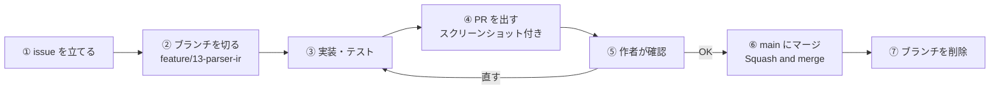

# 開発の進め方

このリポジトリでは、すべての作業を **issue → ブランチ → PR** の順で進める。人も AI エージェントも同じ決まりに従う。



## 1. issue

- 作業は必ず issue から始める。issue のない作業はしない。
- 1つの issue は、1つの PR で終わる大きさにする。大きければ分ける。
- テンプレート（機能・検証・不具合）を使い、「やること」「完了条件」「依存」「ブランチ名」を書く。

| ラベル | 用途 |
|---|---|
| `epic` | マイルストーン（M0〜M5）のまとめ。個々の作業は子 issue にする |
| `enhancement` | 機能の追加・変更 |
| `spike` | 試作による検証（結果は issue に報告し、設計に反映する） |
| `bug` | 不具合 |
| `documentation` | 文書だけの変更 |

## 2. ブランチ

- `main` に直接コミットしない。ブランチは `main` から作る。
- 1つの issue に1つのブランチ。
- 名前は **`<種類>/<issue番号>-<英語の短い説明>`**。小文字・数字・ハイフンだけを使う。

| 種類 | 用途 | 例 |
|---|---|---|
| `feature/` | 機能の追加 | `feature/13-parser-ir` |
| `fix/` | 不具合の修正 | `fix/31-missing-footer` |
| `spike/` | 試作による検証 | `spike/9-dom-measure` |
| `docs/` | 文書だけの変更 | `docs/2-workflow` |
| `refactor/` | 動作を変えない整理 | `refactor/40-split-core` |
| `test/` | テストだけの追加・修正 | `test/42-golden-fixtures` |
| `chore/` | 設定・依存関係・CI | `chore/12-monorepo-setup` |

`claude/…` のように、種類や issue 番号のない名前は使わない。

## 3. コミット

[Conventional Commits](https://www.conventionalcommits.org/ja/v1.0.0/) の形式で書き、本文に issue 番号を入れる。

```text
feat: 見出しのレベルから slideLevel を自動で判定する

Refs #15
```

種類は `feat`・`fix`・`docs`・`style`・`refactor`・`perf`・`test`・`chore`。

## 4. PR

- 1つの issue に1つの PR。本文に `Closes #番号` を書く。
- タイトルはコミットと同じ形式（例：`feat: 見出しと --- でスライドを区切る`）。
- テンプレートの「スクリーンショット」「確認したこと」を埋める。
- CI が通ってから確認を依頼する。
- マージは作者が行う（Squash and merge）。マージしたらブランチを削除する。

### スクリーンショット

見た目に関わる変更では、**スクリーンショットを必ず載せる**。文章だけの説明では確認できないため。

- 変更前と変更後を並べる。スライドが複数あるときは、縮小画像の一覧にする。
- 画像は `docs/screenshots/<issue番号>/` にコミットし、PR の本文から参照する。
- 幅は 1280px 程度にし、1枚あたり 500KB 以下を目安にする。

## 5. 進み具合の報告

- 報告は、スクリーンショット・表・図を中心に短く書く。文章だけで済ませない。
- 検証（`spike`）の結果は、表やグラフにして issue に書く。

## 6. マイルストーン

| マイルストーン | issue |
|---|---|
| M0 事前検証 | #3 |
| M1 書けば映る | #4 |
| M2 自動でいい感じ | #5 |
| M3 アプリで編集 | #6 |
| M4 動く図 | #7 |
| M5 受け渡し | #8 |

M2 以降は、そのマイルストーンを始めるときに子 issue に分ける。
