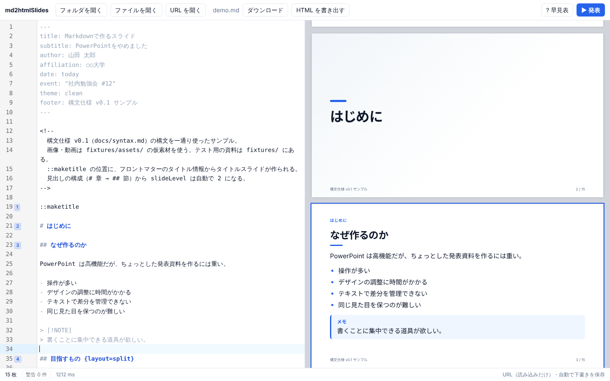
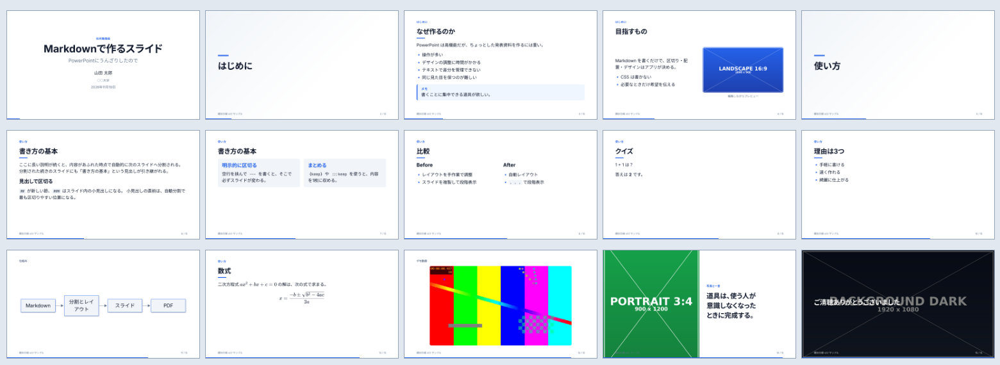
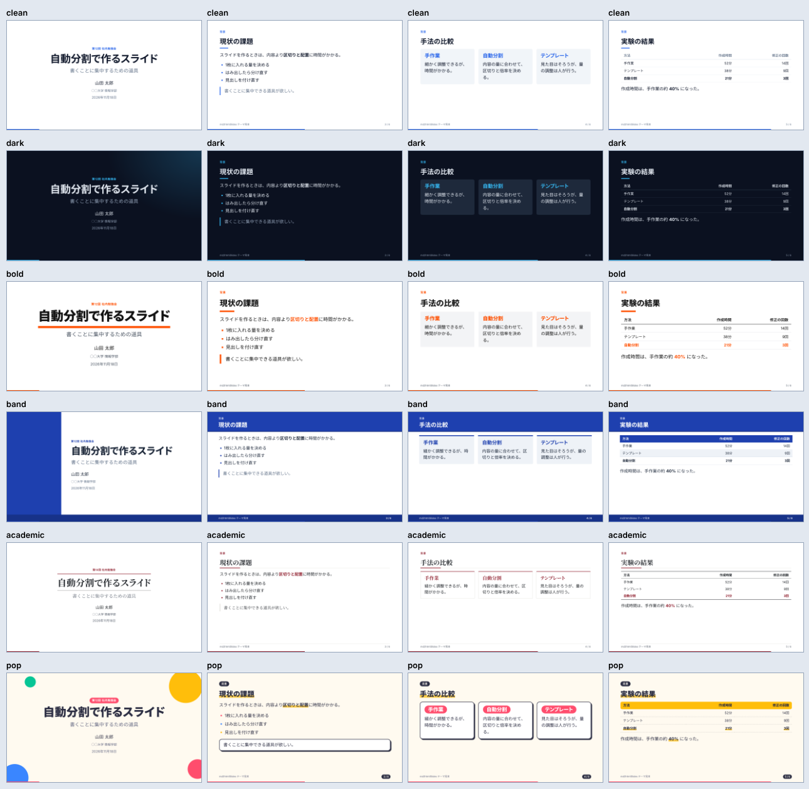
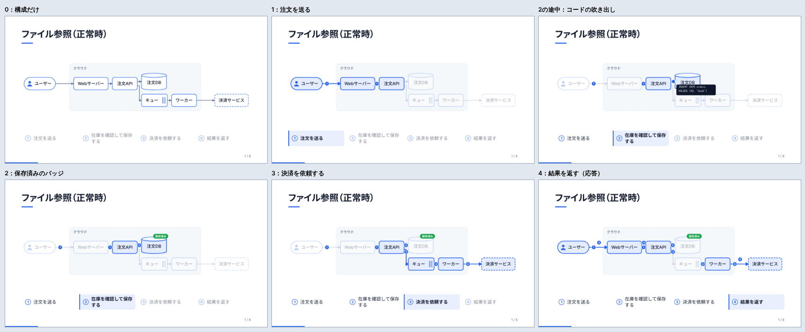

# md2htmlSlides

Markdown を書くだけで、区切り・配置・デザインが整った HTML スライドを作り、そのまま発表できる。PowerPoint を開かずに、テキストだけで発表資料を作るための道具。



**すぐに試す：[Web エディタ](https://nasu726.github.io/md2htmlSlides/)**（インストール不要。一度開けばオフラインでも使える）

## できること

| 機能 | 内容 |
|---|---|
| 自動で区切る | 見出しと `---` でスライドに分ける。1枚に収まらない節は、意味のまとまりを崩さない位置で自動で分け、見出しを引き継ぐ |
| 自動で並べる | 内容から8種類のレイアウトを選ぶ（文章と画像を左右に、画像を格子に、一文を中央に大きく、など）。`{layout=split}` で指定もできる |
| テーマ | 6種類（clean・dark・bold・band・academic・pop）。`accent:` で色だけ変えられる |
| 段階表示 | `. . .`・`:::steps`・`{step}` で順番に見せる。コードの行ハイライト `{lines="1\|2-3"}` |
| 図・数式・コード | Mermaid、数式（KaTeX）、コードの色分け（Shiki）、ページ送りに合わせて動く構成図 |
| 発表 | 全画面・キー操作・発表者ビュー（ノート・経過時間・次のスライド）・一覧・切り替え効果 |
| 書き出し | HTML（フォルダ）、単一 HTML（1ファイルで配布。ネットワークなしで開ける）、PDF（ステップごとのページも） |
| エディタ | プレビューとの同期、書き間違いの警告と修正の候補、サジェスト、早見表、挿入メニュー |

## 書き方

```markdown
---
title: Markdownで作るスライド
theme: clean
---

# はじめに

## なぜ作るのか

PowerPoint は高機能だが、ちょっとした発表資料を作るには重い。

- 操作が多い
- デザインの調整に時間がかかる

## 目指すもの {layout=split}


Markdown を書くだけで、区切り・配置・デザインはアプリが決める。

. . .

- 必要なときだけ希望を伝える
```

[examples/demo.md](examples/demo.md)（130 行）から作ったスライド：



書き方の全体は [構文仕様](docs/syntax.md) にある。エディタでは `Ctrl+/` で早見表が開き、空の行で `/` を押すと挿入メニューが出る。

### テーマ



### 動く構成図

構成とシナリオをテキストで書くと、ページ送りに合わせてリクエストの流れが動く（[仕様](docs/arch-diagram.md)）。

````markdown
```arch
user ユーザー [user]
group クラウド
  web Webサーバー [server]
  db  注文DB [database]

user -> web -> db

scenario 正常時
  step 注文を送る
    user -> web : POST /orders
  step 保存する
    web -> db
    db: 保存済み
```
````



## はじめ方

### Web エディタ

[https://nasu726.github.io/md2htmlSlides/](https://nasu726.github.io/md2htmlSlides/) を開く。

| 開き方 | 使えるブラウザ | 保存 |
|---|---|---|
| フォルダを開く | Chrome・Edge | その場で上書き（Ctrl+S） |
| ファイルを開く・ドラッグ＆ドロップ（画像も一緒に選ぶ） | すべて | ダウンロード |
| URL を開く・`?src=URL`（GitHub・Gist の画面の URL もそのまま使える） | すべて | ダウンロード |

- 書いている内容は、ブラウザに下書きとして自動で保存される
- 「▶ 発表」か F5（プレビューでは S）で、見えているスライドから発表を始め、Esc でエディタに戻る
- 「HTML を書き出す」で、素材を埋め込んだ HTML を1つダウンロードできる

### コマンドライン（CLI）

Node.js 22 以上と pnpm（`corepack enable` で使えるようになる）が要る。

```sh
pnpm install && pnpm build
alias mds="node $PWD/apps/cli/dist/bin.js"

mds dev deck.md                # プレビュー（保存するたびに反映。S で発表）
mds build deck.md -o dist      # dist/index.html と素材を書き出す
mds build deck.md --single     # 素材を埋め込んだ deck.html を1つだけ書き出す
mds pdf deck.md                # deck.pdf（--steps でステップごとのページ）
```

| オプション | 内容 |
|---|---|
| `--no-measure` | ヘッドレス Chromium での計測（自動分割と、収まらないスライドの確認）を省く |
| `--video-limit <MB>` | `--single` で、これより大きい動画は埋め込まない（既定 10。0 は動画を埋め込まずポスターだけ、-1 は無制限） |
| `--steps` | PDF をステップごとのページにする（フロントマターの `pdf: { steps: each }` と同じ） |

計測と PDF にはヘッドレス Chromium を使う。見つからなければ手元の Chrome を探し、なければ計測を省いて書き出す（`npx playwright install chromium` で入れられる）。書き出した HTML は、ブラウザで開くだけで発表できる（`file://` でも動く）。

### 発表のキー操作

| キー | 動作 |
|---|---|
| → / Space / PageDown / Enter | 次へ（段階表示があれば、次のステップ） |
| ← / PageUp / Backspace | 前へ |
| Home / End | 最初 / 最後のスライド |
| 数字 → Enter（または G） | そのページへ |
| O | 一覧（矢印で選んで Enter で開く） |
| P | 発表者ビューを開く・閉じる |
| F | 全画面 |
| B / . | 画面を暗くする |
| ? | キー操作の一覧 |

## ドキュメント

| 文書 | 内容 |
|---|---|
| [構文仕様](docs/syntax.md) | スライド用 Markdown の書き方 |
| [動く構成図の仕様](docs/arch-diagram.md) | 構成図とシナリオの書き方 |
| [サンプル資料](examples/demo.md) | 構文を一通り使った例 |
| [仕様書（What / Why）](docs/requirements.md) | 何を、なぜ作るか |
| [設計プラン](docs/design.md) | どう作るか。生成の流れ、自動分割・自動レイアウト、スライドショー、エディタ、ロードマップ |
| [テスト用の資料](fixtures/README.md) | 観点ごとのテスト用 Markdown と、期待する結果 |
| [開発の進め方](CONTRIBUTING.md) | issue・ブランチ・PR の決まり |

## 開発

| コマンド | 内容 |
|---|---|
| `pnpm install` | 依存関係を入れる |
| `pnpm build` | 型チェックとビルド（エディタは `apps/web/dist` に書き出す） |
| `pnpm --filter @mds/web dev` | エディタの開発用のサーバー（http://localhost:5173/） |
| `pnpm test` | 単体テスト（Vitest） |
| `pnpm test:e2e` | ブラウザでのテスト（Playwright）。初回は `pnpm exec playwright install chromium` |
| `pnpm lint` | ESLint と Prettier の確認 |
| `pnpm format` | Prettier で整形する |

| ディレクトリ | 内容 |
|---|---|
| `packages/core` | パース・分割・レイアウト・描画（DOM に依存しない） |
| `packages/runtime` | 発表用のプレイヤー、動く構成図の配置と再生、印刷の準備 |
| `packages/themes` | テーマ（clean / dark / bold / band / academic / pop） |
| `packages/embeds` | コードの色分け・数式・Mermaid（CLI とエディタで共通） |
| `apps/cli` | コマンドライン `mds` |
| `apps/web` | Web エディタ（PWA。GitHub Pages に公開） |
| `e2e/` | ブラウザでのテスト |
| `fixtures/` | テスト用の資料 |
| `spikes/` | 設計を決めるための検証（試作のスクリプトと結果） |
