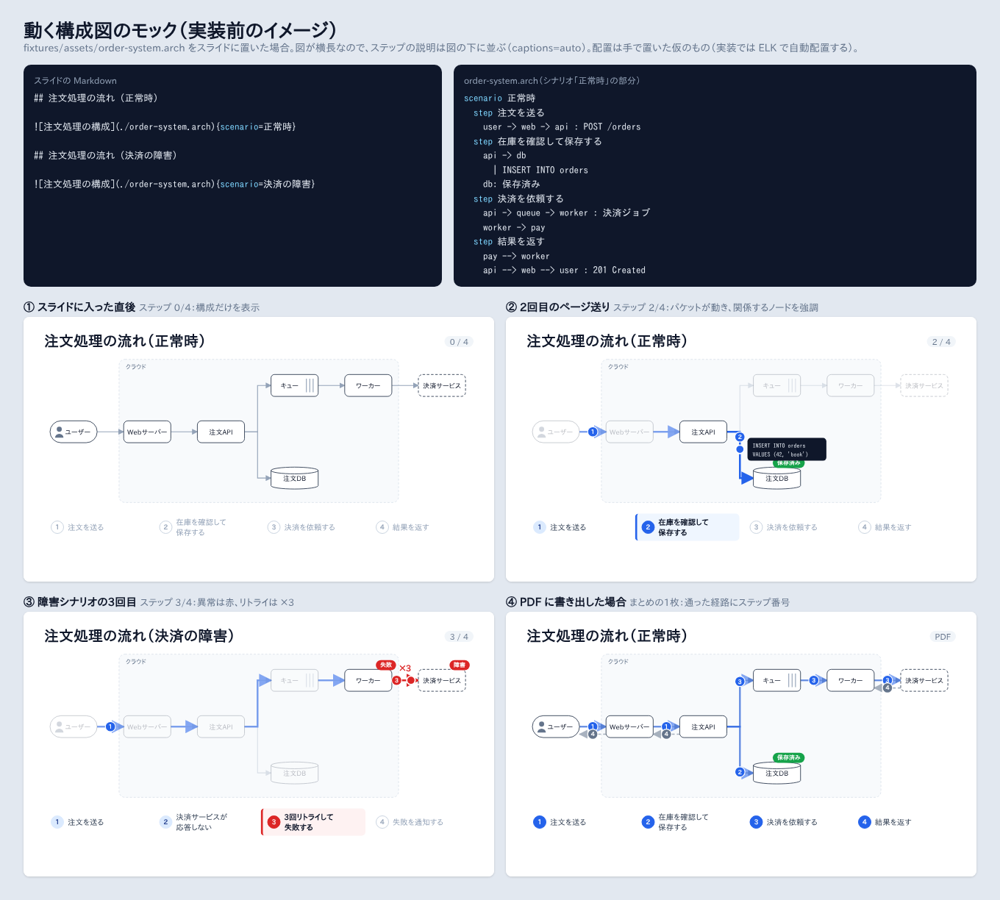

# 動く構成図 仕様 v0.1

> システムの構成図をテキストで書き、データの流れをステップごとにスライドの中で再生する機能。
> [DynamicArchitectViewer](https://zenn.dev/junue/articles/64a4b7092826bf)（以下 DAV）の考え方を参考にした、この製品独自の形式。
> 全体の設計は [設計プラン](./design.md)、ほかの構文は [構文仕様](./syntax.md) を参照。

## 0. 位置づけ

- **目的**：テキストで書いた動く構成図を、生成した HTML のスライドの中で、発表のページ送りに合わせて再生する。
- **DAV との関係**：DAV の拡張機能や `.dav` ファイルは使わない。考え方（テキストだけで定義する・座標を書かない・ステップごとにパケットと状態で流れを見せる）を参考にし、記法はスライドで使いやすい形に作り直す。DAV とは互換性がない。
- **名前**：機能名は「動く構成図」、コードブロックの言語名とファイルの拡張子は `arch`。
- **ほかとの違い**：Mermaid のフローチャートと同じ静止画にとどめず、「時間とともに変わるシステム」（障害と回復・ノードの中身・構成図とシーケンス図の同期・構成の変化）をスライドで見せる。この方向は #149 の試作で決め、[§11](#11-これから足すものm8179) の順に足す。

## 1. Markdown で動く図を書くときの難しさと、この形式での解決

| 難しさ | この形式での解決 |
|---|---|
| 図の定義が長いと、スライドの Markdown が読みにくくなる | 定義を別ファイル（`.arch`）に置き、画像と同じ書き方で参照できる。短い図はコードブロックに直接書ける |
| 同じ構成で「正常時」と「障害時」を別のスライドで見せたい | 構成とシナリオを分けて書き、スライドごとに `{scenario=…}` で選ぶ。構成は1回書けばよい |
| 図の動きと、発表のページ送りがずれる | シナリオの1ステップを、発表の1ステップにする。`. . .` や `{step}` と同じ番号の列に入る |
| 図だけでは「今なにが起きているか」が伝わらない | ステップごとに説明文を書き、図の横に番号付きのリストとして自動で表示する（今のステップを強調する） |
| スライドは狭く、大きな図では文字が読めない | 文字が小さくなりすぎるときだけ、各ステップに関係するノードへ自動で寄る（カメラ） |
| PDF では動きが見えない | 通った経路にステップ番号を残した「まとめの1枚」にする。ステップごとのページにもできる |
| 書き間違いに気付きにくい | 存在しないノードやつながっていない経路を、エディタで行番号付きで警告する |

## 2. 例

````markdown
## 注文処理の流れ（正常時）

{scenario=正常時}

## 注文処理の流れ（決済の障害）

{scenario=決済の障害}
````

`order-system.arch`：

```text
direction: right

user   ユーザー       [user]
group クラウド
  web    Webサーバー  [server]
  api    注文API      [server]
  db     注文DB       [database]
  queue  キュー       [queue]
  worker ワーカー     [server]
pay    決済サービス   [external]

user -> web -> api
api -> db
api -> queue -> worker
worker -> pay

scenario 正常時
  step 注文を送る
    user -> web -> api : POST /orders
  step 在庫を確認して保存する
    api -> db
      | INSERT INTO orders
      | VALUES (42, 'book')
    db: 保存済み
  step 決済を依頼する
    api -> queue -> worker : 決済ジョブ
    worker -> pay
  step 結果を返す
    pay --> worker
    api --> web --> user : 201 Created

scenario 決済の障害
  step 注文を送る
    user -> web -> api
    api -> queue -> worker : 決済ジョブ
  step 決済サービスが応答しない
    worker -> pay
    pay: 障害 !
  step 3回リトライして失敗する
    worker -> pay x3
    worker: 失敗 !
    note: リトライの間隔は指数的に延びる
  step 失敗を通知する
    api --> web --> user : 500
```

表示のイメージ（実装前のモック）：



## 3. 構成の書き方

1行に1つの要素を書く。`#` から行末まではコメント。インデントは半角スペース2つ。

### 3.1 ノード

```text
<ID> <表示名> [<種類>]
```

- ID は英数字・`_`・`-` で、つながりやシナリオから参照するのに使う。表示名と種類は省略できる（表示名の既定は ID、種類の既定は `server`）。
- 表示名に空白を含めるときは `"…"` で囲む。
- 行末に `max=5` を書くと、中身の数の上限になる（1〜20。§4 の中身の表に枠を5つ出す。#181）。

| 種類 | 見た目 |
|---|---|
| `user` | 人のアイコン付き |
| `client` | ブラウザ・アプリ |
| `server` | 角丸の四角（既定） |
| `database` | 円柱 |
| `queue` | 区切り線の入った四角 |
| `storage` | ファイルのアイコン付き |
| `external` | 破線の枠（外部サービス） |

### 3.2 グループ

```text
group <表示名>
  <中のノード（インデントする）>
```

グループは入れ子にできる。グループもつながりの端点にはならない（つなぐのはノードだけ）。

### 3.3 つながり

| 書き方 | 意味 |
|---|---|
| `a -> b` | a から b への矢印 |
| `a <-> b` | 両方向の矢印 |
| `a -- b` | 向きのない線 |
| `a -> b -> c` | 続けて書ける（`a -> b` と `b -> c`） |
| `a -> b : HTTPS` | 線にラベルを付ける |

### 3.4 向き

`direction: right`（左から右、既定）か `direction: down`（上から下）。配置はすべて自動で決まり、座標は書かない。

### 3.5 別の構成（#183）

```text
user ユーザー [user]
app  アプリ
db   DB [database]
user -> app -> db

layout 分割後
  user  ユーザー [user]
  gw    ゲートウェイ
  group サービス
    order 注文 < app
    pay   決済 < app
  db DB [database]
  user -> gw
  gw -> order
  order -> db
```

- 字下げしない構成が最初の構成。`layout <名前>` の下に、別の構成を全部書く（字下げは2つ分ずらして読む）
- 行末の `< app` は「app から分かれた」印（構成を切り替えると、app の位置から出てくる）
- シナリオの `layout <名前>`（§4）で切り替える。同じ ID のノードは同じものとして動く

## 4. シナリオの書き方

```text
scenario <名前>
  step <説明文>
    <動き>
```

ステップの中には、次の「動き」を上から順に書く。1つのステップの中の動きは、書いた順に再生する。

| 書き方 | 動き |
|---|---|
| `a -> b` | パケットが a から b へ移動する |
| `a -> b -> c` | a → b → c と続けて移動する |
| `a -> b : POST /orders` | パケットにラベルを付ける |
| `a -> b` の次の行に `\| …` | パケットにコードの吹き出しを付ける（複数行可） |
| `b --> a` | 応答のパケット（破線で、逆向きに戻る） |
| `a -> b x3` | 3回繰り返す（リトライなど） |
| `b: 処理中` | b に状態のバッジを付ける |
| `b: 障害 !` | 異常の状態（赤で表示） |
| `b: -` | 状態のバッジを消す |
| `b: down`・`b: down 応答なし` | b を止める（灰色にし、赤い「停止」か文言のバッジ。消すまで残る）（#180） |
| `b: up`・`b: up 復旧` | 止めた b を戻す（文言があれば緑のバッジ） |
| `a -x b`（`x3` も可）・`: ラベル` | 届かない移動：パケットが b の手前で止まり、× とラベルを出して消える。繰り返すときは、パケットに回数（`1/3`）を付ける |
| `a -/- b` | つながりを切る（赤い破線と ×。消すまで残る）。切った線を通る移動は届かない |
| `a -/- b : -` | 切ったつながりを戻す |
| `queue += 注文1 注文2` | queue の中身に足す（空白で区切る）。ノードの下（`direction: down` では右）の表に札を足す（#181） |
| `queue -= 注文1` | 中身から除く（残りを詰める） |
| `db.注文 = 3件`・`db.注文 = -` | キーと値を書く・消す（表に「注文　3件」の行） |
| `layout 分割後`・`layout -` | 構成を切り替える（`-` で最初の構成）。§6.5 の動きでつなぐ（#183） |
| `note: …` | このステップの発表者ノート（スライドには出ない） |

- 状態のバッジは、消すまで次のステップ以降も残る。バッジ・止める・切るは、ステップの中の書いた位置で変わる（その後の移動に効く）。
- 止まったノードへの移動（`->`）も、`-x` と同じく届かない。`-x` は前後に空白が要る（ID に `-` と `x` を使えるため）。`-x` と `-/-` は構成の中では使えない。
- 届かない移動のラベルは、パケットではなく × の横に出す（理由を書く場所）。
- 中身とキーと値も、消すまで残る。`max=` の上限を超えて足した中身は入らず、赤い札と × を出して消える（表の枠は満杯で赤）。`#` はコメントなので、中身の名前には使えない。
- 構成に書いていない経路を動かした場合は警告し、その経路を点線で一時的に描く。
- シナリオを1つも書かなければ、動きのない構成図になる。

## 5. スライドでの使い方

### 5.1 書き方は2通り

| 書き方 | 向いている場面 |
|---|---|
| コードブロック ```` ```arch {scenario=正常時} ```` | 小さな図。その場で全部書きたいとき |
| ファイル参照 `{scenario=決済の障害}` | 大きな図。同じ構成を複数のスライドで使うとき |

### 5.2 属性

| 属性 | 値 | 既定 | 説明 |
|---|---|---|---|
| `scenario` | シナリオ名 / `none` | 最初のシナリオ | 再生するシナリオ。`none` なら動きのない構成図 |
| `captions` | `auto` / `side` / `below` / `none` | `auto` | ステップの説明リストを図の横・下に出すか、出さないか。`auto` は図の縦横比で決める（§5.4） |
| `focus` | `auto` / `none` | `auto` | カメラ（§6.2）を使うか |
| `view` | `arch` / `both` / `sequence` | `arch` | 見せ方。`both` は構成図とシーケンス図を並べ、`sequence` はシーケンス図だけ（§6.4、#182） |
| `step` | — | — | 図そのものを、段階表示で後から出す |
| `width` | `60%` など | — | 図の幅を固定する |
| `caption` | 文字列 | — | 図のキャプション |

### 5.3 段階表示との関係

- シナリオが N ステップなら、そのスライドのステップ数に N が加わる。図の位置で、`. . .` や `{step}` と同じ番号の列に入る（[構文仕様 §5](./syntax.md#5-段階的表示)）。
- スライドに入った直後（ステップ 0）は、構成だけを表示する。
- 1つのスライドに置ける動く構成図は1つまで（2つ以上は警告）。

### 5.4 レイアウト

自動レイアウト（[設計プラン §5](./design.md#5-自動レイアウト)）では、図をメディア、説明のリストを本文として扱う。

| 条件 | レイアウト |
|---|---|
| `captions=auto`（既定）で、図が横長（2.2:1 以上） | `stack`（図の下に説明を横一列に並べる） |
| `captions=auto`（既定）で、それ以外 | `split`（図 3：説明 2） |
| `captions=side` | `split`（図 3：説明 2） |
| `captions=below` | `stack`（図の下に説明） |
| `captions=none` で、ほかに本文がない | `media` |

横長の図の横に説明を置くと、図が縮んで文字が読めなくなるため。`view=both`・`sequence` では、並べた全体（またはシーケンス図）の縦横比で決める。基準は、文章とメディアを左右に並べるかどうかの基準（[設計プラン §5.3](./design.md#53-split-の細かい規則)）と同じ。

## 6. 表示と動き

### 6.1 1ステップの再生

1. このステップに関係するノードと経路を強調し、それ以外を薄くする
2. パケットが経路に沿って移動する（1区間あたり約0.6秒、吹き出しはパケットと一緒に動く）
3. 状態のバッジを更新する
4. 通った経路に、ステップ番号の印を残す
5. 説明リストの、今のステップを強調する

- 戻る操作では、アニメーションせずに、前のステップが終わった状態を表示する。
- `prefers-reduced-motion` が有効なら、パケットを動かさず、経路の強調と番号だけで示す。

### 6.2 カメラ

図をスライドの領域に収めたとき、文字が約14px より小さくなる場合だけ、各ステップに関係するノードを囲む範囲へ寄る。寄っている間は、図の右下の外に全体図（ミニマップ）を表示する。文字が十分に読める大きさなら、カメラは動かさない。

### 6.3 色

テーマのトークンから決める。通常のパケットと経路は `--accent`、異常は赤系、応答は `--muted`。止めたノードは `--muted` の灰色、切った線と届かない移動の × は赤（#180）。中身の札は `--accent`、表の枠は `--border`、満杯は赤（#181）。ノードの種類ごとの見た目もテーマで変えられる。

### 6.4 構成図とシーケンス図（#182）

`view=both` で、同じシナリオから作ったシーケンス図を構成図の横（または下）に並べる。記法は足さない。

- シーケンス図は、シナリオに出てくる順にノードを並べ、移動の区間ごとに矢印（応答は破線、届かないものは手前で ×）を引く。状態・止める・戻す・中身の変化は、そのノードの縦の線に注記し、切ったつながりは赤い破線。ステップの最初の行に番号を付ける
- 並べ方は、全体の縦横比が 2:1 に近いほう（構成図が縦長なら横、横長なら下）
- 再生では、構成図のパケットとシーケンス図の点を同じ時間で動かし、矢印を1本ずつ出す。まだのステップの行は隠し、終わったステップは薄くする。まとめ（一覧・PDF）はすべての行を同じに見せる
- カメラ（§6.2）は使わない
- `view=sequence` は構成図を出さず、シーケンス図の点だけを動かす

### 6.5 構成の変化（#183）

`layout <名前>` で構成を切り替えると、そのあいだを動きでつなぐ（約1秒）。

- 同じ ID のノードは、前の位置から新しい位置へ動く。`< app` のノードは、app の位置から小さく出て広がる
- 新しいノードは現れ、なくなるノードは消える。線とグループは、前の構成のものを消してから、新しい構成のものを出す
- 図の範囲（viewBox）も、新しい構成に合わせて移す（図の枠は、いちばん大きい構成に合わせて取る）
- バッジ・止めたノード・中身はノードの ID で引き継ぐ。番号の印は、切り替えた後の移動から数え直す
- 戻る・一覧・印刷では、その時点の構成を、動かさずに出す

## 7. 書き出し

| 出力 | 表示 |
|---|---|
| HTML | §6 の動き（runtime で再生する） |
| PDF（既定） | まとめの1枚：すべての経路にステップ番号、最後の状態のバッジ（止めたノード・切った線・中身も）、届かない移動の ×、説明リストはすべて表示 |
| PDF（`pdf: { steps: each }`） | 各ステップが終わった状態を1ページずつ |

## 8. 実装の方針

- **パーサ**：行単位の自作パーサ。インデントで入れ子を読む。エディタの警告のため、すべての要素に行番号を持たせる。
- **配置**：[ELK](https://eclipse.dev/elk/)（elkjs）の layered アルゴリズムを使う。入れ子のグループの配置に強い。配置はシナリオに依存しない（ステップでノードが動かない）ので、構成の部分のハッシュでキャッシュする。
- **描画**：SVG。プレビューとビルドのときに配置を計算して座標を SVG に書き込むので、書き出した HTML には配置エンジンを含めない。
- **再生**：パケットは CSS の `offset-path` と Web Animations API で経路に沿って動かす。runtime に足すコードは 5KB（gzip）程度を目標にする（実際はカメラを含めて約 6KB。構成図があるときだけ入れる）。
- **埋め込みの内部ステップ**（[設計プラン §7.1](./design.md#71-プラグインインターフェース)）の最初の図にする：シナリオのステップ数を `data-mds-substeps` に書き、`window.mdsEmbeds.arch` の `show`・`play` でステップの状態を表示する（#108）。
- **警告**：未定義のノード、構成にない経路、使われていないノード、存在しないシナリオ、インデントの崩れ、1つのスライドに2つ以上の図。

**配置と描画の実装（#107）**：

- runtime の `renderArch`（外側の変数を使わない1つの関数）を、テーマの CSS と同梱のフォントのページで呼ぶ。CLI は計測の Chromium、エディタは計測用の iframe。ページには先に elkjs（`elk.bundled.js`）を入れる。書き出した HTML には SVG だけが入る
- ノードの大きさは、本文のフォントで表示名の幅を測って決める（20px で描き、枠に合わせて縮める）
- 色は SVG に書かず、クラスを付けて基本の CSS で塗る（ノードの枠は `--mds-accent`、線は `--mds-muted`、グループは `--mds-surface` を地に混ぜた面）。テーマと `accent:` に合う
- 矢印の先は、`marker` を使わずに線の端に直接描く（同じ図を何枚かのスライドに置くと ID が重なり、隠れたスライドの印を参照して消えるため）
- グループの名前は、線の上に地の色を敷いて描く（S4）
- 再生（#108）のため、ノードに `data-node`、つながりに `data-from`・`data-to` を付ける
- 配置の判定（§5.4）：説明のリスト（`<ol class="mds-arch-captions">`）を文章として数え、図が横長なら stack（説明は図の下に横一列）、そうでなければ split（図 3：説明 2、図は左）。`captions=none` か `scenario=none` で説明がなければ media
- `.arch` のファイル参照・```` ```arch ```` は、描く関数がなければ（Chromium がないなど）、今までどおり枠・コードのまま

**再生の実装（#108）**：

- core は、図（`<figure data-embed="arch">`）に再生するシナリオを `data-arch-steps`（ステップごとの移動と状態の JSON）と `data-mds-substeps`（ステップ数）で書く。ステップの番号は段階表示と同じ順に振る（§5.3）。ステップの `note:` は、そのスライドの発表者ノートに「① 注文を送る：…」の形で足す
- runtime の `ARCH_SCRIPT`（`startArch`）が、埋め込みの内部ステップ（`window.mdsEmbeds`、[設計プラン §7.1](./design.md#71-プラグインインターフェース)）に `arch` を登録する。構成図があるときだけ HTML に入れる。gzip で約 4KB
  - `show(図, 段)`：動かさずに「段」個のステップが終わった状態にする（戻る・一覧・発表者ビュー・印刷）
  - `play(図, 段)`：1つ進めたときだけ。前の状態から、パケットを区間ごとに動かし（`offset-path` と Web Animations API、1区間 0.6 秒）、最後に `show` と同じ状態にする
- 状態は SVG に足す `<g class="arch-fx">`（番号の印・バッジ・仮の点線）と、ノード・線のクラス（`is-active`・`is-dim`）だけで持つ。色は基本の CSS（テーマの変数）
- パケットは区間ごとに動かし、ノードの中は通さない（S4）。逆向きにたどれるのは、応答（`-->`）か向きのない線（`--`・`<->`）だけ（パーサの `arch/unknown-route` と同じ判定）。構成にない経路は、ノードの枠の外どうしを点線で結んで、そのステップのあいだだけ描く
- 同じ線を2回以上通ったら、番号の印を線に沿ってずらし、線が短ければ線の横に積む
- ノードの枠は `renderArch` が `data-box` に書き、再生ではそれを読む（`getBBox` は、発表者ビューの複製のようにまだ描かれていない要素では 0 になるため）
- `prefers-reduced-motion` のときは `show` だけ（パケットを動かさない）

**カメラと PDF の実装（#109）**：

- 文字の大きさ：全体を見せたときのノードの表示名（20 単位）が、スライドの何 px になるか（SVG の `clientWidth`・`clientHeight` と viewBox から。変形の前の大きさなので、画面の大きさによらない）。最初に測って図に `data-arch-label` で覚え、発表者ビュー・印刷の複製に引き継ぐ
- 14px より小さい図だけ、ステップのノードを囲む範囲（余白 48）へ viewBox を動かす（0.5 秒。図の縦横比のまま、文字は 26px まで）。範囲が図の全体の 92% 以上なら寄らない。`focus=none` の図（`data-arch-focus="none"`）は寄らない
- 寄っている間は、図の右下の外にミニマップ（構成だけの複製と、見ている範囲の枠）を出し、図の枠で切る。カメラが働くのは図が幅で縮んだとき（上下に空きがある）なので、図に重ねない
- まとめ（埋め込みの `show` の `summary`）：一覧と PDF（既定）。通ったすべての経路に番号、最後の状態のバッジ、構成にない経路はすべて点線、強調・薄くするのはなし、説明はすべて同じ、カメラなし（全体）
- PDF の `--steps` は発表と同じ表示（各ステップが終わった状態、強調とカメラあり）

**障害と回復の実装（#180）**：

- core は、移動に届かない区間 `b`、状態に止める・戻す `p`（`d`・`u`）、つながりを切る `{k: [a, b], u?}` を `data-arch-steps` に書く
- runtime は、バッジ・止めたノード・切ったつながりを1つの状態（world）にまとめ、ステップの動きを書いた順に当てはめる。再生ではその場で描き直し（`.arch-fx` の中の `.arch-state`）、戻る・一覧・印刷の `show` も同じ順にたどる
- 届かない区間は、行き先の手前（最大 44）で止めて × を出し、その先へは進まない。切った線の × は、切った側から 3 分の 1 あたり（線の始めの番号の印と、真ん中のラベルを避ける）
- 前のステップだけの印（構成にない経路の点線・届かない移動の ×）は、次のステップを動かす前に消す
- `down` の文言を省いたときのバッジは、資料の言語で「停止」（`lang: en` なら Down）

**ノードの中身の実装（#181）**：

- core は、ノードに `max`、動きに中身（`{q, a | d}`）とキーと値（`{v, n, t}`）を足す
- `renderArch` は、シナリオをたどって、ノードごとに同時に入る中身の数（`max` があればそれ）と名前の幅、キーと値の幅から表の大きさを決め、ELK のノードの外のラベル（右向きの図は `OUTSIDE V_BOTTOM H_CENTER`、下向きは `OUTSIDE V_CENTER H_RIGHT`）にして場所を取る。札はノードの幅に近い幅で折り返す。場所はノードの `data-table`、札の並べ方は `data-chips`（枠の数・1行の数・札の幅）、上限は `data-max` に書く
- runtime は、中身とキーと値を、止めたノードなどと同じ状態（world）に持ち、`.arch-state` の中に表を描き直す。足した札はふわっと出し、入らない中身は表の右上に赤い札と × を出して消す。カメラは表も入れて寄る

**構成図とシーケンス図の実装（#182）**：

- `renderArch` は、シナリオごとにシーケンス図の中身の SVG（原点から）と大きさを `sequences` に入れて返す。行に `data-k`（ステップ）・`data-a`（動きの番号）・`data-s`（区間）を付ける。届かない区間は、止めたノード・切ったつながりを書いた順にたどって決める（runtime と同じ規則）
- core の `archView` は、`view=` に合わせて、構成図の SVG の中身とシーケンス図（`<g class="arch-seq">`）を1つの SVG に並べ、縦横比を返す（配置の判定・説明のリストもこの縦横比）
- runtime は、再生で行を1つずつ出し（`.is-future` を外す）、矢印に沿って点を動かす。`show` は、まだ・今・終わったのクラスを付ける

**構成の変化の実装（#183）**：

- core は、`layout` の下を別の構成（`layouts`）として読み、ノードに分かれる元（`from`）、動きに切り替え（`{y}`。空なら最初の構成）を足す。参照の警告は、シナリオのその時点の構成で確かめる（`arch/unknown-layout`、今の構成にないノード）
- `renderArch` は、構成ごとに ELK で配置して、構成ごとのまとまり（`.arch-layout`、`data-layout`・範囲 `data-bounds`）を1つの SVG に重ねる。今の構成のほかは隠す。図の枠はいちばん大きい構成。`< app` はノードの `data-from`
- runtime は、ノードと線を今の構成の中から探す。`show` は切り替えをたどって構成を選び、再生は前後の構成を両方出して、ノードを CSS の transform で動かし、範囲を移す

**パーサと警告の実装（#106）**：`@mdhs/core` の `parseArch`（構成図のソース → 構成とシナリオ）と `collectArch`・`archDiagnostics`（スライドの中の図を集め、md の行の警告にする）。

| 警告のコード | 内容 | 重さ |
|---|---|---|
| `arch/syntax` | 読めない行 | 警告 |
| `arch/indent` | インデントの崩れ（奇数・タブ・グループの外で字下げ） | 警告 |
| `arch/unknown-kind` | ノードの種類の書き間違い（近い候補を出す） | 警告 |
| `arch/duplicate-node` | 同じ ID のノードが2つ | 警告 |
| `arch/orphan-code` | 移動のない `\|` の吹き出し | 警告 |
| `arch/unknown-node` | 未定義のノード | 警告 |
| `arch/unknown-route` | 構成にない経路（`a -> b` は a→b・a↔b・a—b のどれか、応答 `-->` は向きを問わない）。構成にない線を切る（`-/-`） | 警告 |
| `arch/unused-node` | どこにもつながっていないノード | 情報 |
| `arch/no-effect` | 止まっていないノードの `up`、切っていない線を戻す（#180）、入っていない中身を除く（#181） | 情報 |
| `arch/invalid-max` | `max=` の値が 1〜20 の整数でない（#181） | 警告 |
| `arch/full` | 上限を超えて中身を足す（入らずに消える）（#181） | 情報 |
| `arch/unknown-layout` | 存在しない構成への切り替え（#183）。未定義のノードの警告は、その時点の構成で確かめる | 警告 |
| `arch/unknown-scenario` | 存在しないシナリオ（あるシナリオの名前を添える） | 警告 |
| `arch/multiple` | 1つのスライドに2つ以上の図 | 警告 |

- コードブロックの中の警告は md の行に直す。ファイル参照（`.arch`）の中の警告は、参照した行に「（order-system.arch の 12 行目）」と添える
- `.arch` のファイル参照は、メディアの種類 `arch` にした（画像として扱わない）
- エディタでは、```` ```arch ```` の中で、行頭のキーワード（`group`・`direction`・`scenario`・`step`・`note`）、`[` の後のノードの種類、矢印の後と動きの行頭のノードの ID、`direction:` の値を候補に出す。シナリオの中では、`b:` の後に `down`・`up`、ID の後の `-`・`+` に動きの記号（`->`・`-->`・`-x`・`-/-`・`+=`・`-=`）を出す（#180・#181）

## 9. DAV から参考にした点と変えた点

| 項目 | DAV | 動く構成図 |
|---|---|---|
| 使う場所 | VS Code の拡張機能、アニメーション SVG の書き出し | スライドの中 |
| 定義する場所 | `.dav` ファイル | コードブロック、または `.arch` ファイル |
| 構成 | ノード・グループ・矢印 | 同じ考え方（ノード・グループ・つながり） |
| 座標 | 書かない（自動配置） | 同じ |
| 時間の流れ | ステップの中に、パケットの移動と状態の変化 | 同じ。加えて応答・繰り返し・吹き出しを短く書ける |
| 再生の操作 | 拡張機能のプレイヤー | 発表のページ送りと同期 |
| 説明 | 吹き出しにコードを載せる | ステップの説明文をリストで表示。吹き出しも使える |
| 正常時と障害時 | 記事の例では、1つの `.dav` に両方の流れをステップとして書かせている | 1つの構成に複数のシナリオを書き、スライドごとに選ぶ |
| カメラ | ステップごとに移動し、ミニマップを出す | 文字が小さくなるときだけ寄る |
| 静止画 | アニメーション SVG | 番号付きのまとめの1枚（PDF） |

## 10. 採用しなかった案

| 案 | 理由 |
|---|---|
| DAV の拡張機能や書き出した SVG をそのまま埋め込む | 発表のページ送りと同期させにくく、テーマにも合わせられない。外部ツールへの依存も増える |
| YAML で書く | 書く量が多く、つながり（`a -> b`）が読みにくい |
| Mermaid の記法を拡張する | Mermaid の構文にはステップを書く場所がなく、バージョンの変化にも追従しにくい |
| シナリオを Markdown の番号付きリストで書く | 説明文と動きの指定が混ざり、どこまでが指定か曖昧になる |

## 11. これから足すもの（M8、#179）

#149 で、7つの案を本物の配置とテーマの上に試作し（[spikes/149-arch-direction](../spikes/149-arch-direction/README.md)、[一覧](./screenshots/149/overview.png)）、Mermaid・D2 ではできない（静止画か、図の切り替えまで）ものから、次の順に足すと決めた。足したものは、§3〜§8 の本文に移す。

| 順 | 機能 | issue | 試作 |
|---|---|---|---|
| 1 | 障害と回復 | #180（済み。§4・§6.3・§8 に移した） | [GIF](./screenshots/149/02-failure.gif) |
| 2 | 状態を持つノード | #181（済み。§3.1・§4・§6.3・§8 に移した） | [GIF](./screenshots/149/01-state.gif) |
| 3 | 構成図とシーケンス図を並べる | #182（済み。§5.2・§6.4・§8 に移した） | [GIF](./screenshots/149/05-two-views.gif) |
| 4 | 構成の変化 | #183（済み。§3.5・§4・§6.5・§8 に移した） | [GIF](./screenshots/149/03-morph.gif) |

### 11.1 障害と回復（#180）

足した。書き方は §4、色は §6.3、実装は §8。

### 11.2 状態を持つノード（#181）

足した。書き方は §3.1・§4、色は §6.3、実装は §8。

### 11.3 構成図とシーケンス図を並べる（#182）

足した。書き方は §5.2、見え方は §6.4、実装は §8。

### 11.4 構成の変化（#183）

足した。書き方は §3.5・§4、見え方は §6.5、実装は §8。

### 11.5 後回しにした案

| 案 | 記法の案 | 後回しにした理由 |
|---|---|---|
| 同時に流れる | `[A] a -> b`・`[B] c -> b`（名前の違う流れは同時に動く）、下にレーン | 11.1・11.2 の後なら小さく足せる |
| 中に入る | ノードの下に中の構成を字下げ、`enter api`・`leave` | 今のカメラ（§6.2）の延長で、入れ子の配置が要る |
| 量を見せる | `a -> b ~ 3000/s`・`capacity=1200/s` | 流量の計算と、流れ続ける表示が重い |
