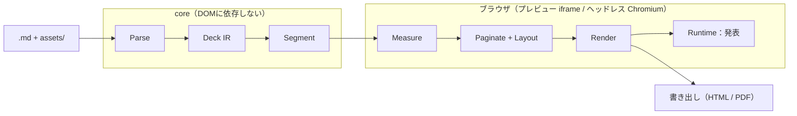
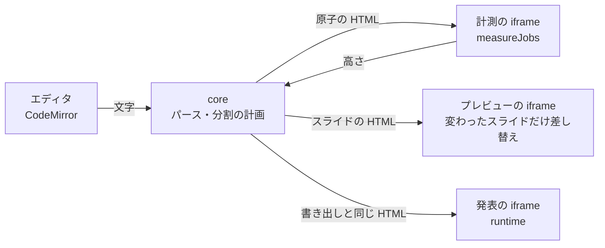

# 設計プラン v0.1

> [仕様書（What / Why）](./requirements.md) に対する How の初版。
> スライド用 Markdown の書き方は [構文仕様](./syntax.md)、使用例は [examples/demo.md](../examples/demo.md) にまとめた。

設計の対象は次の3つ。目標は「手軽な編集・軽量な生成・リッチなデザイン」の3点。

| 対象 | 本書での節 |
|---|---|
| 1. スライド作成のための構文 | [構文仕様](./syntax.md)（本書 §1 に決定の経緯） |
| 2. Markdown → スライドの生成 | §3〜§7、§10、§11 |
| 3. スライドショー | §8 |

## 0. 設計方針

1. **Markdownを唯一の正本にする。** 分割位置やレイアウトの希望もすべて Markdown のテキストに書く。「5枚目は2段組」のような状態をアプリ側に別に持たない。指定は内容のそばに書かれるので、文章を編集してスライドの枚数が変わっても指定が付いてくる（提案C）。
2. **追加構文には「意図」を書く。** 「横に並べる」「ここで区切る」「1枚にまとめる」を書けるだけにし、CSSの値は書かせない。
3. **自動化は「候補から選ぶ」方式にする。** 分割位置もレイアウトも、決まった候補を評価関数で比べて選ぶ。同じ入力からは必ず同じ出力を出す。
4. **変更の影響を局所化する。** 分割は「節」ごとに独立に計算し、ある節を編集しても他の節のスライドは変わらない（提案B）。
5. **レンダリングは実ブラウザで行う。** 文字の計測・分割・描画はすべて実ブラウザ上で行い、プレビュー・発表・PDF の見た目を一致させる。

---

## 1. 決定事項（未決事項への回答）

| # | 未決事項 | 決定 | 決め方 |
|---|---|---|---|
| 1 | メタデータの範囲 | MVP は17キー。後から `transition`・`pdf` を足して今は19キー（[構文仕様 §1.1](./syntax.md#11-キーの一覧)）。うち7つはタイトル情報。それ以外は段階的に追加する | 提案 |
| 2 | 自動分割をどこまで任せるか | 既定は全自動（見出し＋あふれ）。利用者は `---`・`{keep}`・`:::keep` で補助する。`split: manual` で自動分割を止められる | 提案 |
| 3 | 自動レイアウトをどこまで任せるか | 8種類のレイアウトから評価関数で選ぶ。カタログにない自由な配置は作らない | 提案 |
| 4 | 指定できるレイアウトの希望の範囲 | 区切る・まとめる・横並び・縦並び・レイアウト名・比率・メディアの位置・背景の8種類 | 提案 |
| 5 | 段階的表示の記法 | `. . .` ＋ `:::steps` ＋ `{step=N}` | **作者が決定** |
| 6 | Mermaid 以外の形式と順序 | Mermaid → 動く構成図（DynamicArchitectViewer を参考にした独自形式。[仕様](./arch-diagram.md)） → KaTeX（数式） → Vega-Lite（グラフ） → Graphviz | 提案（DAV の扱いは作者の補足を受けて変更） |
| 7 | アニメーションの範囲 | ①段階的表示、②埋め込んだ図が持つ段階・再生をスライドの操作と同期、③動画とループ再生。独自のアニメーション記述は扱わない | 提案 |
| 8 | 動的コンテンツの書き出し | PDF では最終状態の静止画にする。オプションでステップごとにページを分ける。動画はポスター画像とリンクにする | 提案 |
| 9 | テーマの数 | 3種類：clean（クリーン/ミニマル）・dark（ダーク/テック）・bold（ボールド/ビビッド）。後から band・academic・pop を足して6種類にした（#93、§6） | **作者が決定** |
| 10 | 書き出しと取り込みの優先順位 | PDF → 単一HTML。PPTX は扱わない（作者の判断：2026-11-19。PPTX をやめるために始めたプロジェクトのため） | **作者が決定** |
| 11 | 短い発表か長い発表か | 両方。想定は5〜60枚、性能は200枚で確認する。長い発表向けに目次・章名表示・一覧・ページジャンプを用意する（目次のほかは作った。§16） | 提案 |
| 12 | オンライン編集・同期の時期 | 初期は対象外。正本はフォルダ内のテキストなので、当面は git やクラウドストレージのフォルダ同期で代わりにする。将来は GitHub 連携 → リアルタイム共同編集の順に検討する | 提案 |
| — | アプリの形態 | Webアプリ（PWA）＋CLI。デスクトップアプリ化（Tauri）は将来の選択肢として残す | **作者が決定** |
| — | タイトルスライド | LaTeX の `\maketitle` と同じ考え方で、タイトル情報をフロントマターに書き、本文の `::maketitle` の位置にタイトルスライドを置く。書かなければ先頭に自動で作る（[構文仕様 §2.2](./syntax.md#22-タイトルスライドmaketitle)） | **作者が決定** |
| — | 提案A / B / C | すべて採用（§4.4・§4.6・§0-1） | 提案 |

---

## 2. 全体構成



| コンポーネント | 役割 |
|---|---|
| `core` | パース、中間表現（IR）、節の原子化、分割・レイアウトのアルゴリズム、HTML 生成。純粋な TypeScript で、DOM には計測インターフェース（Measurer）越しにだけ触る |
| `runtime` | 発表用プレイヤー（ページ送り・段階表示・発表者ビュー）。書き出した HTML にも同梱する |
| `themes` | clean / dark / bold / band / academic / pop の CSS と定義ファイル |
| `embeds` | Mermaid などの図の埋め込みプラグイン |
| `apps/web` | エディタ（PWA）。プレビューは隔離した iframe で表示する |
| `apps/cli` | `dev`（ローカルサーバー＋ファイル監視）、`build`（静的 HTML）、`pdf`（`check` は予定。§13） |

### エディタでのデータの流れ

1. CodeMirror でテキストが変わる
2. `core` がパースして IR を作り、分割の計画（測るもの）を立てる
3. 計測用の iframe（テーマの CSS とフォントがある）で高さを測る。測ったことのあるものは測らない
4. `core` が分割・レイアウト・描画を行い、HTML が変わったスライドだけを `postMessage` でプレビューの iframe に送る
5. スライドの対応表（どの行がどのスライドか、どこで自動分割されたか）と診断結果を、行番号欄の目印と警告に使う

（実装は §9.6）

---

## 3. 生成パイプライン

| 段階 | 入力 → 出力 | 実行場所 | キャッシュのキー |
|---|---|---|---|
| 1. Parse | テキスト → markdown-it のトークン＋フロントマター | メインスレッド / Worker | —（全体で数ミリ秒） |
| 2. IR 構築 | トークン → Deck IR（節のツリー＋ブロック、行範囲、ハッシュ） | 同上 | ブロックの内容ハッシュ |
| 3. 解決 | 画像サイズの取得、コードハイライト、図の描画（非同期） | Worker / iframe | （ハッシュ, テーマ） |
| 4. 原子化 | 節 → 原子の列と、区切り候補ごとのペナルティ | core | 節のハッシュ |
| 5. 計測 | （原子, 幅, テーマ, 倍率） → 高さ | iframe の DOM | 左と同じ |
| 6. 分割＋レイアウト | 原子の列＋高さ → ページ × レイアウト | core | 節のハッシュ＋計測結果 |
| 7. 描画 | ページ → `<section class="slide">` の HTML | core | スライドのハッシュ |
| 8. 反映 | スライド ID をキーに DOM の差分を反映 / 発表 | iframe / runtime | スライド ID |

### 3.1 中間表現（IR）

最初の案。実際の型は `packages/core/src/ir.ts`（Deck・SectionNode・Block）と `slides.ts`（Slide）にある。

```ts
interface Deck {
  meta: DeckMeta;               // フロントマター（検証し、既定値を補ったもの）
  slideLevel: 1 | 2 | 3;
  sections: SectionNode[];      // 見出しのツリー
  diagnostics: Diagnostic[];    // 警告（行番号付き）
}

interface SectionNode {
  id: string;                   // 見出しテキストのslug（重複時は連番）。本文を編集しても変わらない
  level: number;
  heading?: Inline[];
  attrs: SlideAttrs;            // layout, keep, ratio, media, hidden, class …
  blocks: Block[];
  children: SectionNode[];
  src: [startLine, endLine];
}

interface Block {
  hash: string;                 // 内容のハッシュ（キャッシュのキー）
  kind: 'paragraph' | 'heading' | 'list' | 'code' | 'table' | 'quote' | 'callout'
      | 'image' | 'video' | 'embed' | 'math' | 'html'
      | 'row' | 'stack' | 'keep' | 'steps' | 'notes' | 'pause' | 'break'
      | 'maketitle';              // 中身（背景・補足・ノート）は children に入る
  sizing: 'rigid' | 'flex';     // 幅から高さが決まる / 空いた領域に合わせて伸縮する（§5.4）
  attrs: ElementAttrs;
  children?: Block[];
  src: [startLine, endLine];
}

interface Slide {
  id: string;                   // `${section.id}#${ページ番号}`
  layout: LayoutName;
  regions: Record<string, Block[]>;  // title / body / media / col1 … などの領域
  heading?: { text: Inline[]; continued: boolean; page: [number, number] };
  background?: Background;
  steps: number;
  notes: Block[];
  scale: number;                // 縮小率（1 なら縮小なし）
  src: [startLine, endLine];
}
```

### 3.2 パーサ

markdown-it に、次の自作プラグインを加える。

- **属性 `{…}`**：既知のキーだけを受け付ける制限付きの解析（[構文仕様 §3.1](./syntax.md#31-書式)）。markdown-it-attrs はどんな `{…}` も属性として拾ってしまうため使わない。
- **コンテナ `:::`**：入れ子はコロンの数で区別する。
- **単独行の指示 `::名前{…}`**：今は `::maketitle` だけを受け付け、それ以外の名前は警告する。
- **`. . .`**：内容が `. . .` だけの段落を pause トークンに変える。
- **フロントマター**：YAML として読み、スキーマで検証する。検証結果はエディタの補完と警告にも使う。

トークンには元の行範囲（`map`）が付いているので、IR の全ノードに行範囲を持たせられる。この行範囲をエディタとプレビューの同期、警告の位置表示、ゴールデンテストに使う。

---

## 4. 自動分割

### 4.1 用語

- **節**：`slideLevel` の見出しから、次の同じレベル以上の見出しの直前まで。1つの節が1枚以上のスライドになる。
- **原子**：これ以上分けない最小単位。段落・画像・コード・表は1つの原子。リストはトップレベルの項目ごとに原子にし、入れ子の項目は親の項目に含める。原子1つが1枚に収まらない場合だけ、表は行ごと、コードは行ごとにさらに分ける。

### 4.2 区切り候補とペナルティ

原子と原子の間すべてが区切りの候補で、それぞれにペナルティを付ける。値は初期値で、S2（§15）で調整する。

| 位置 | ペナルティ |
|---|---|
| `---` | 必ず区切る |
| 小見出し（`slideLevel` より深い見出し）の直前 | 0（最も区切りやすい） |
| 段落と段落の間、ブロックとブロックの間 | 10（小見出しとその直後の1ブロックだけがページの最後に残る場合は +50。#92） |
| 箇条書きのトップレベル項目の間 | 30（区切ると1項目だけが残る場合は +50） |
| 表の行の間（次のスライドにも見出し行を出す） | 60 |
| コードの空行 / 空行以外の行の間 | 70 / 90 |
| 長い段落の文の切れ目（段落1つが1枚に収まらないとき） | 80（まだ作っていない。今は最大 60% まで縮めて警告する） |
| 小見出しの直後、画像とキャプションの間、「：」で終わる段落の直後、`:::keep` と `. . .` でつながった範囲の中 | 区切らない |

**コードの行での分割（#82）**：8行以上のコードは、行ごとの原子にする。測るときは1行ずつ枠（`pre`）ごと描き、枠の分の高さ（空のコードの高さ）は2行目から引いて、ページの先頭で足す（表の見出し行と同じ扱い）。分けたページでは、行をまとめて1つのコードに戻す。空行の後は 70、ほかの行の間は 90 で、1〜2行だけが残る区切りには、さらに 50 を足す。図にするコード（`mermaid`・`arch`）と、属性（`{step}` など）のあるコードは分けない。

### 4.3 アルゴリズム（節ごとの動的計画法）

```text
best[0] = 0
for j in 1..n:                        # j = ページの最後の原子の次
  for i in j-1 down to 0:             # ページ = atoms[i..j)
    if 区切れない(i): continue
    fit = bestFit(atoms[i..j))        # §5.2：収まるレイアウト×倍率の中で最良のもの
    if fit がない: break              # i を前に戻すほど内容が増えるので打ち切る
    cost = best[i] + fit.cost
         + breakPenalty(i)            # §4.2
         + fillBadness(atoms[i..j), isLast = (j == n))
         + PAGE_COST                  # 枚数が少ないほど良い
    best[j] = min(best[j], cost)
```

- `fillBadness`：最後以外のページは、余白が多いほどコストを上げる（`100·(1 − 充填率)²`）。節が2枚以上になるときは、どのページも充填率が35%未満ならコストを上げる（`400·((0.35 − 充填率)/0.35)²`。数行だけのページを避けるため）。`PAGE_COST` は 40。重みは S2 で決めた（§15.1）。
- **下の余白**：本文の高さの 6% は空けておき、そこまで埋まるページは「収まっていない」とみなす（縮めるか分ける）。下端ぎりぎりまで文字が来ると見づらいため（#92）。発表時に縮めて収める処理（fitSlides）も、同じ余白が残るまで縮める。本文が中身の高さで決まるレイアウト（statement・section）には設けない。
- **ページの高さの見積もり**：原子の高さの合計に、原子の間隔を足す。間隔はブロックの間なら `--mds-gap`、同じリストの項目の間なら 0.25em、同じ表の行の間なら 0。小見出しの途中から始まるページは、再掲する小見出しの高さを、表の途中から始まるページは見出し行の高さを足す。
- 1つの節に含まれる原子は普通50個未満なので、O(n²·レイアウト数) で十分速い。
- **あふれたときの順序**：分割する前に、bestFit の中で「別のレイアウトで収める（例：短い項目が多いリストを2段組にする）」と「縮小する」を試す。縮小は 85% までは軽いコスト（`300·(1 − 倍率)`）、85% より下は重いコスト（1 あたり 2000）で、75% までにとどめる。75〜85% の縮小は、数行だけのページを避けるときにだけ選ばれる（#42 で 02-tech-talk の「計測に使ったスクリプト」が導入文1行のページとコードのページに分かれたため、80% から 75% に広げた）。どちらもコストに加算するので、1枚に詰め込むか2枚に分けるかは、上のコストの比較で決まる。
- **原子1つが1枚に収まらないとき**：表やコードは内部で分ける。画像・図は伸縮する要素なので必ず収まる。それ以外は最大60%まで縮小し、警告を出す。

### 4.4 意味的なまとまりを守る（提案A）

§4.2 で「区切らない」とした位置は、内容のつながりを守るためのもの。

- 見出しは、その下の最初の内容と同じスライドに置く。
- 画像とキャプションは離さない。
- 「次の3点です：」のような導入文は、続くリストと同じスライドに置く。
- `. . .` で順番に見せる範囲は1枚に保つ。

### 4.5 見出しの継承

- 続きのスライドの先頭に、節の見出しを同じ文言で表示する。「（続き）」などの印は付けない（#91。何枚目かはフッターのページ番号でわかる）。
- 小見出しの途中で区切った場合は、小見出しも同じ文言で先頭に再掲する。
- `---` で手動で区切った場合も同じように扱う。自動の区切りを `---` で固定しても、見た目は変わらない。
- 引き継いだ見出しは、タイトル領域のあるレイアウト（`stack` `split` `columns` `grid`）でだけ表示する。
- `slideLevel` より浅い見出し（章）の名前は、タイトル領域のあるスライドで、見出しの上に小さく表示する（`.mds-chapter`。band は上の帯に入れる）。表示するかを選ぶキー（`breadcrumb`）は予定。

### 4.6 安定性（提案B・C）

- **節ごとに独立して計算する。** 節 A を編集しても、節 B の分割は変わらない。
- **結果は入力だけで決まる。** 「前回の区切り位置をなるべく保つ」ような編集履歴に依存する仕組みは採用しない。採用すると、編集を重ねたプレビューと、まっさらな状態から作った書き出し結果が食い違うため。
- **ID を安定させる。** スライド ID は「節のslug＋ページ番号」にする。本文を編集しても ID が変わらないので、DOM の差分反映や URL（`#/intro`）が安定する。
- **指定は内容のそばに書く。** `{keep}` や `:::row` は Markdown の該当箇所に書かれているので、前後の文章が増減しても指定が一緒に動く。

---

## 5. 自動レイアウト

### 5.1 レイアウトの種類と自動で選ばれる条件

| レイアウト | 主な条件 |
|---|---|
| `title` | `::maketitle`、または自動で作るタイトルスライド。中に `{bg=left}` / `{bg=right}` の画像があれば、左右に分けた配置にする |
| `section` | `slideLevel` より浅い見出し（章の短い導入文があれば一緒に表示する）。または本文のない見出し |
| `statement` | 本文が短い一文（1文・80字まで）だけ、または引用1つだけ。節の見出しは上に小さく表示する |
| `media` | 画像・動画・図だけ（＋キャプション）。`width=` で幅を固定した画像は、伸縮させずに文章と同じ流れに置くので、media・grid・split の判定に数えない |
| `grid` | 画像2〜6枚で、文章が少ない |
| `split` | 文章＋メディア（画像・動画・図・コード）1つで、文章が半分の幅に収まる |
| `columns` | 分量の近い小見出しが2〜4個ある、または `:::row` |
| `stack` | 上のどれにも当てはまらないとき（既定） |

### 5.2 選び方

1. ページの内容から特徴を集める：ブロックの種類と数、文字量、リストの項目数と平均の長さ、メディアの数と縦横比、コードの行数と最長行、小見出しの数とそれぞれの分量のばらつき。
2. 各レイアウトについて「適合度」を計算し、そのレイアウトで収まるかを計測で確かめる。
3. 収まるレイアウトのうち、適合度が最も高いものを選ぶ。同点のときは決まった順で選ぶ。

これを分割アルゴリズムの `bestFit` の中で行うので、分割とレイアウトを同時に決められる。

> **今の実装（#43）**：分割した後のページごとに、内容の特徴からレイアウトを選んでいる。分割の計測は stack の幅で行い、例外として、短い項目が多いリスト（8項目以上・各10文字以下）は2段組の高さで、続けて並べた画像だけの段落は格子の高さで測る。split・columns で縦に長くなったページは縮小で収める。レイアウトの候補ごとに測って分割と一緒に選ぶのは、まだしていない。計測は「ブロック×幅」の単位でキャッシュする。幅は全幅・1/2・3/5・2/5・1/3 など数種類しかないので、計測の回数は少ない。

### 5.3 `split` の細かい規則

- メディアは右側に置く（`media=left` で左に置ける）。`ratio=` は「左：右」の比で、自動で決めた比（文章：メディア）はメディアが左なら入れ替える。
- 比率はメディアの縦横比で決める。縦長の画像なら「文章60：メディア40」、横長なら 50：50。とても横長（2.2:1 以上）なら左右に並べず、上下に積む `stack` にする。
- 最長行が60文字を超えるコードは左右に並べず、上下に積む。

### 5.4 伸縮する要素

画像・動画・図は「最小サイズ」と「縦横比」だけを持ち、分割時には最小サイズとして数え、レイアウト後に空いた領域いっぱいまで広げる。これには2つの効果がある。

- 画像が余白を埋めるので、見た目が整う。
- 図の非同期描画が終わっても分割が変わらない。描画結果が分割に影響しないので、プレビューがちらつかない。

### 5.5 組版

- 見出しには `text-wrap: balance` を使い、行の長さを揃える。
- 見出しは、core が描画するときに BudouX で文節の切れ目に `<wbr>` を入れ、`word-break: keep-all` で表示する。こうすると、どのブラウザでも PDF でも同じ位置で改行される。`auto-phrase` は Chromium にしかなく、ほかのブラウザでは改行の約 6 割が文節の途中になったため（S3、§15.1）。
- 禁則処理には `line-break: strict` を使う。
- ブロックの間隔は margin ではなく、flex の `gap` で取る。margin の相殺が起きないので、ページの高さは「各ブロックの高さの合計＋gap×(個数−1)」で正確に計算できる。

---

## 6. テーマ

- テーマは「CSS ＋ 定義ファイル」でできている。定義ファイルには ID、フォント、色のトークン、Shiki のテーマ、Mermaid の配色との対応を書く。
- **デザイントークン**は CSS カスタムプロパティで表す：`--slide-bg` `--slide-fg` `--accent` `--muted` `--surface` `--font-heading` `--font-body` `--font-mono` `--fs-title` `--fs-h2` `--fs-body` `--gap` `--pad-x` `--pad-y` `--radius` など。
- 各レイアウトの格子（CSS grid）は core の基本 CSS で定義し、テーマはトークンと装飾だけを変える。こうすることで、計測と表示で同じ寸法になる。
- コードハイライトと Mermaid の配色はテーマのトークンから作るので、図もテーマに自動で合う。
  - コードハイライト（#68）は書き出しのときに Shiki で行い、発表用の runtime には含めない。Shiki の「CSS 変数のテーマ」を使い、span には `color: var(--mds-code-token-keyword)` のように変数だけを書く。色の値はテーマの CSS が決める（既定は基本の CSS、テーマによって上書き）ので、テーマを変えても色分けをやり直さなくてよい。文字は変えずに span で囲むだけなので、計測の高さは変わらない。
  - 読み込む文法は、資料で使っている言語だけ。Shiki が知らない言語と、図にするコード（`mermaid`・`arch`・`math`）は色を付けない。
- **上書きの段階**：フロントマターの `accent` → （後で）`colors` / `fonts` → `css:` のカスタムCSS（`.mds-deck` 以下だけに効く） → スライドごとの `.class`。

| テーマ | 方向性 | フォントの候補 |
|---|---|---|
| clean | 白が基調で余白が広く、アクセントは控えめ。汎用 | 標準的なゴシック体＋欧文サンセリフ |
| dark | 背景が暗く、コードと図が映える。技術発表向け | ゴシック体＋等幅フォント |
| bold | 大きな文字と強い色。LT・ピッチ向け | 太いゴシック体 |
| band | 見出しとフッターに色の帯。社内資料・報告向け（#93） | ゴシック体 |
| academic | 明朝の見出し、罫線、論文の表。学会・講義向け（#93） | 見出しは明朝体（Noto Serif JP）、本文はゴシック体 |
| pop | 明るい色と丸み、太い見出し。勉強会・LT 向け（#93） | 太いゴシック体 |

作ったテーマの中身（#66）：

| テーマ | 色 | 文字の大きさ | 飾り |
|---|---|---|---|
| clean | 白地・紺の文字・青のアクセント | 本文 28px・見出し 44px | 見出しの下の短い線、章扉は薄いグラデーション |
| dark | 紺の地（`#0b1120`）・明るい文字・水色のアクセント | clean と同じ | コードは地より暗くして枠を付ける。注意書きは半透明の色。章扉とタイトルは右上にアクセントの光 |
| bold | 白地・黒の文字・オレンジのアクセント | 本文 31px・見出し 52px（太さ 800〜900） | タイトルスライドと章扉は白地に、見出しの下のアクセントの色の太い線（#100・#114・#137）。リストは四角の印。コードは clean と同じ大きさ |
| band（#93） | 白地・紺の帯（`--mds-band`、既定は accent） | 本文 27px・見出し 38px | 見出し（と章の名前）を上の帯に、フッターとページ番号を下の帯に入れる。タイトルスライドと章扉は白地に、左に帯の色の縦の帯（スライドの幅の 28%）を置き、文字は右に左揃え（#100・#114・#137）。表の見出し行も帯の色 |
| academic（#93） | 白地・臙脂のアクセント・明るいコード | 本文 26px・見出し 42px（明朝） | 見出しの下に罫線、論文の表（上下に太い罫線・縦線なし）、フッターの上に細い罫線。章扉は薄い紙の色、タイトルは罫線で挟む |
| pop（#93） | クリーム色の地・ピンクのアクセントと黄・青・緑 | 本文 28px・見出し 46px（太さ 900） | 見出しに蛍光ペンの線、小見出しは丸い札、箇条書きの印は項目ごとに色が変わる。カード・引用は太い枠とずらした影。章扉とタイトルは丸い模様 |

- bold は文字が大きいので、自動分割で枚数が少し増える（fixtures 03 は 35 → 40 枚）。計測はテーマの CSS で行うので、あふれることはない。
- academic の明朝体（Noto Serif JP）は、academic のときだけ読み込み、書き出しに埋め込む（`themeFonts`）。見出しのほか引用などにも使うので、本文の文字をすべて入れる（見本の資料で、埋め込むフォントは 130KB → 240KB）。
- 章扉とタイトルスライドを一面の色で塗るのは主張が強すぎるので、bold・band はやめた（章扉は #100、タイトルスライドは #137）。比べた案は [#100 の4案](./screenshots/100/)、[#114 の番号なしの A・B](./screenshots/114/options.png)、[#137 のタイトルスライドの案（bold）](./screenshots/137/bold-options.png)・[（band）](./screenshots/137/band-options.png) に残した。どちらも章扉と同じ形の A 案にした。章扉に番号は付けない（作者の指定）。
- タイトルスライドのロゴの位置は保留（作者の判断：2026-11-19。今はタイトルの上）。
- bold の線の色は `--mds-strong`（既定は `--mds-accent`）。`accent:` で変えると線の色も変わる。
- 小さな文字（章の名前・イベント名・statement の見出し・カードの見出し・リンク・動く構成図の説明の番号）のアクセントは `--mds-accent-text`（既定は `--mds-accent`）。アクセントが明るい bold・pop は、アクセントを 78% にして黒を混ぜた色にし、地とのコントラストを 4.5 以上にする（明るいままだと 3.0〜3.3）。全面の背景の上では、暗い画像なら白、明るい画像なら本文の色にする（#131）。線・面・リストの印には、明るいアクセントをそのまま使う。

**フォント**（#67 で決めた）：

| 用途 | フォント | ライセンス |
|---|---|---|
| 欧文 | Inter（可変、太さ 100〜900） | OFL-1.1 |
| 日本語 | Noto Sans JP（可変、太さ 100〜900） | OFL-1.1 |
| コード | JetBrains Mono（可変） | OFL-1.1 |
| 明朝体（academic の見出し。#93） | Noto Serif JP（可変、太さ 200〜900） | OFL-1.1 |

- academic の見出し以外は、どのテーマも同じ書体を使い、テーマの違いは太さ・大きさ・色で出す。ファイルは npm の fontsource（`@fontsource-variable/…`）から取る。
- 書体の名前は `MDS Inter` などの独自の名前にする。PC に同じフォントがあってもなくても、同梱したものを使う。
- **書き出し（`mds build`）**：スライドに表示される文字だけに絞り（サブセット）、`data:` URL で HTML に埋め込む。1つの文字は、実際に描く書体の1つのファイルにだけ入れる。fixtures で 57〜218 KB。`file://` で開いても読み込める。
- **`mds dev` と計測**：分割ファイル一式を unicode-range で読み込む（ブラウザが必要なファイルだけを読む）。字形と幅はサブセットと同じなので、計測と書き出しの結果はずれない。計測の前に `document.fonts.load()` で、測る文字の分を読み込んでおく。
- 書き出した HTML は、フォントを読み込み終わったら（`document.fonts.ready`）もう一度収め直す。
- 見出しと statement の大きな一文は約物を詰める（`font-feature-settings: 'palt'`）。本文は詰めない。
- 絵文字は同梱しない（Noto Color Emoji は約 10 MB）。OS の絵文字フォントで表示する。発表用の操作画面（ヘルプ・発表者ビュー）も OS のフォント。
- 背景が明るい画像か暗い画像かは平均輝度から判定し、文字色を自動で切り替える（M3）。

---

## 7. 図表の埋め込み

### 7.1 プラグインインターフェース

```ts
interface EmbedPlugin {
  name: string;                                   // 'mermaid'
  match: { lang?: string[]; ext?: string[] };     // ```mermaid / .mmd
  cacheKey(src: string, ctx: EmbedContext): string;
  render(src: string, ctx: EmbedContext): Promise<RenderResult>;  // SVG / HTML（静的な表示）
  steps?(src: string): number;                    // 内部ステップ数（段階表示との同期用）
  mount?(el: HTMLElement, ctx: EmbedContext): EmbedController;   // 動きのある表示
  snapshot?(el: HTMLElement, step: number): Promise<Blob>;        // PDF 用の静止画
}

interface EmbedController {
  enter(): void;                  // スライドに入った（再生開始）
  goto(step: number): void;       // 発表者がステップを進めた・戻した
  leave(): void;                  // スライドから出た（一時停止）
  destroy(): void;
}
```

**発表中のライフサイクル**：準備（ビルドまたはプレビュー時に描画してキャッシュ） → mount（前後1枚まで近づいたら） → enter → goto(n) → leave → destroy。

**内部ステップの実装（#105）**：上のうち、段階表示と同期する部分だけを作った（下の `window.mdsEmbeds`）。図を描く部分は、Mermaid・動く構成図・数式のそれぞれを CLI とエディタが呼び出していて、プラグインとして登録する仕組みにはしていない。mount・enter・leave・snapshot もない（PDF は `show` で表示した状態をそのまま印刷する）。

- core：内部に段を持つ要素は `data-mds-substeps="N"` を付けて書き出す。ステップの番号付け（`numberSteps`）は、その位置で N 個の番号を続けて取り、`data-substeps="3,4,5"`（各段に進むステップ）にする。`. . .`・`{step}` と同じ列に入る
- runtime：`window.mdsEmbeds[種類]` に `show(el, 段)`（動きなしでその段の状態にする）と `play(el, 段)`（1つ進めたときの動き）を登録する。種類は要素の `data-embed`。段は「今のステップまでに来た番号の数」。戻る・一覧・発表者ビュー・印刷は `show`、1つ進めたときだけ `play`
- `show` の3つ目の引数 `summary`（#109）：一覧と PDF（既定）では `true`。1つの段を強調せず、全体をまとめて見せる（動く構成図のまとめの1枚）。PDF のステップごとのページと発表者ビューは `false`
- 状態は DOM の属性とクラスだけで持つので、発表者ビュー（スライドの複製）と PDF のステップごとのページ（複製）でも同じ関数で表示できる
- 書き出した HTML の初めの状態は最後の段（プレビュー・PDF と同じ）。発表では、スライドに入るときに runtime が段 0 に戻す
- 最初の種類はコードの行ハイライト（`code-lines`、runtime に入れてある）。動く構成図（`arch`）は別のスクリプトで足す

### 7.2 Mermaid（M3）

- プレビュー iframe の中で `mermaid.render()` を呼ぶ。`securityLevel: 'strict'` を指定し、配色はテーマのトークンから作る。
- 結果は（ソースのハッシュ, テーマ）でキャッシュする。SVG は `viewBox` を使って領域に合わせて拡大・縮小する。
- Mermaid はファイルサイズが大きいので、文書に Mermaid があるときだけ読み込む。
- 構文エラーはスライド上に枠で示し、エディタには行番号付きで警告する。入力中は最後に成功した描画を表示したままにし、ちらつきを防ぐ。

**実装（#71）**：CLI（`mds build`・`mds dev`・`mds pdf`）では次のようにした。エディタでも、計測用の iframe で同じ関数を呼ぶ（#84、§9.6）。

- 図は**ビルド時に描いて SVG を HTML に埋め込む**。書き出した HTML には Mermaid を含めないので、開くのが速く、オフラインでも同じに見える。
- 描くのは計測と同じヘッドレス Chromium。テーマの CSS とフォントを読み込んだページに `mermaid.min.js` を入れ、`@mds/runtime` の `renderMermaid()` を呼ぶ。
- 配色はデッキの CSS 変数（`--mds-bg`・`--mds-fg`・`--mds-accent`・`--mds-surface`・`--mds-border`・`--mds-muted`）から作り、Mermaid の `base` テーマの `themeVariables` に渡す。地が暗ければ `darkMode` にする。フォントは本文のフォント。
- 文字は既定の 16px ではなく 22px で描く。図は枠に合わせて縮めるので、ノードの間隔に対して文字を大きくしておくと、スライドの上で読みやすい。
- core は描画の関数（`DiagramRenderer`）を `RenderEnv.diagram` で受け取るだけで、Mermaid には依存しない。関数がなければ（Chromium がないなど）コードブロックのまま出す。
- 図の縦横比は配置の判定（§5）と分割の計画に使う。とても横長の図（2.2 以上）は上下に並べる。
- 構文エラーは、スライドに「Mermaid の構文エラー」の枠とメッセージを出し、警告（`diagram/mermaid-error`）にはフェンスの行とエラーの行を足した行番号を付ける。

### 7.3 動く構成図（M4）

詳細は [動く構成図の仕様](./arch-diagram.md) にまとめた。要点：

- [DynamicArchitectViewer](https://zenn.dev/junue/articles/64a4b7092826bf)（DAV）の考え方（テキストだけで定義する・座標を書かない・ステップごとにパケットと状態で流れを見せる）を参考にした、**この製品独自の形式**。DAV の拡張機能や `.dav` ファイルは使わず、生成した HTML のスライドの中で動く。
- 構成（ノード・グループ・つながり）とシナリオ（ステップ）を分けて書く。同じ構成を、スライドごとに別のシナリオ（正常時・障害時など）で再生できる。
- シナリオの1ステップが、発表の1ステップになる。ステップの説明文は、図の横に番号付きのリストとして自動で表示する。
- コードブロック ```` ```arch ```` に直接書くか、`.arch` ファイルを `{scenario=…}` で参照する。
- 配置は ELK で自動計算し、ビルド時に座標を SVG に書き込む。書き出した HTML には配置エンジンを含めない。
- 埋め込みプラグイン API（§7.1）の最初の実装にする。

### 7.4 その後の形式

KaTeX（M3、数式）→ Vega-Lite（グラフ）→ Graphviz（viz.js の WASM 版）。PlantUML は描画にサーバーが必要なので、必要になったときに検討する。

**数式の実装（#72）**：書き方と `$` の規則は [構文仕様 §7.3](./syntax.md#73-数式)。

- core は `$…$`・`$$`・```` ```math ```` を見つけるだけで、描く関数（`RenderEnv.math`）を受け取る。Mermaid と同じく、core は KaTeX に依存しない。関数がなければ TeX をコードとして出す。
- CLI は、資料に数式があるときだけ KaTeX（0.19）を読み込み、`renderToString` で HTML にする。書き出した HTML には描いた結果（HTML と読み上げ用の MathML）だけが入り、KaTeX の JS は入らない。
- KaTeX の CSS とフォントも、数式があるときだけ入れる。
  - `mds dev` と計測：フォント一式を `/__mds/fonts/katex/` から読み込む。計測の前に、KaTeX の書体をすべて読み込んでおく。
  - 書き出し：使った書体だけを、使った文字だけに絞って埋め込む。書体は、描いた HTML のクラスを KaTeX の CSS の規則に当てはめて決め（`.mathnormal` → KaTeX_Math の斜体、`.mathbb` → KaTeX_AMS など）、文字は KaTeX の文字の寸法表で、その書体が持つものだけにする。
- 独立した数式は、ブロックの種類 `math` にする（配置の判定では文章でも図でもない）。分割では1つの原子として扱い、数式を描いた後の高さで測る。
- 数式のエラーは、KaTeX が示す TeX の中の位置から、ファイルの中の行を求めて警告する（`math/katex-error`）。

---

## 8. スライドショー（runtime）

### 8.1 構造

```html
<main class="mds-deck theme-clean">
  <section class="mds-slide layout-split" data-id="intro" data-steps="2">…</section>
</main>
```

1280×720 の論理キャンバスに描き、`transform: scale()` で画面に合わせて拡大・縮小する（余った部分は帯にする）。表示環境によって再レイアウトは起きない。

### 8.2 操作

| キー | 動作 |
|---|---|
| → / Space / PageDown / Enter | 次のステップ（最後のステップなら次のスライド） |
| ← / PageUp / Backspace | 前のステップ |
| Home / End | 最初 / 最後のスライド |
| 数字 → Enter（または G） | 指定したページへ移動 |
| F | 全画面 |
| P | 発表者ビューを開く・閉じる（§8.4） |
| O | 一覧表示 |
| B / . | 画面を暗転 |
| ? | ヘルプ |
| Esc | 一覧・ヘルプを閉じる（一覧は開いたときのスライドに戻る）。開いていなければスライドショーを終え、プレビューの同じスライドに戻る（`mds dev` のときだけ。§13） |

一覧表示（O）では、矢印でスライドを選び（↑ ↓ は1行ずつ。選んだスライドが見える位置まで動かす）、Enter・Space で開く。クリックでも開ける。大きな資料でも探せるように、サムネイルの左上に番号を出す。開いたときは今のスライドが中央に来る（#110）。

市販のプレゼンリモコン（PageUp / PageDown を送るもの）でも操作できる。タッチ操作のスワイプにも対応する。URL は `#/12/2`（12枚目の2ステップ目）。

動画や YouTube・Vimeo の埋め込みをクリックした後も、上のキーはスライドの操作に使う（動画のシークなどには使わない）。動画の再生・停止はクリックで行う。一覧でスライドをクリックしても、中の動画は操作されない。

### 8.3 段階的表示

各スライドは `steps` を持つ。状態は（スライド番号, ステップ）で表す。`data-step="k"` を持つ要素は、現在のステップが k 以上のときに表示する。埋め込んだ図の内部ステップは `window.mdsEmbeds` の `show`・`play` で同期する（§7.1）。

### 8.4 発表者ビュー

`window.open` で別ウィンドウを開き、現在のスライド・次のスライド・ノート・経過時間・時計・ステップの進み具合を表示する。空のウィンドウを開き、発表の画面の文書から中身を書き込んで同期する（`window.open` で得た参照を使う）。`file://` で開いた HTML でも動くようにするため、BroadcastChannel やサーバーには頼らない。

**「現在」の枠には、いつも観客が見ているものを出す。** 発表者ビューで押したキーは、ページ送りと暗転のほかは発表者ビューの中で完結させる。

| キー | 発表の画面で押したとき | 発表者ビューで押したとき |
|---|---|---|
| P | 発表者ビューを開く・閉じる | 発表者ビューを閉じる（発表は続く） |
| Esc | 一覧・ヘルプを閉じる | 一覧・ヘルプを閉じる。開いていなければ発表者ビューを閉じる |
| O | 一覧 | 発表者ビューの中に一覧を出す。選ぶまで観客の画面は変わらない |
| ? | ヘルプ | 発表者ビュー用のヘルプ |
| F | 全画面 | 発表者ビューのウィンドウを全画面 |
| B / . | 暗転 | 観客の画面を暗転（「現在」の枠も暗くし、「暗転中」と示す） |
| → ← など | 両方が進む | 両方が進む |

- 観客の画面で一覧やヘルプを出している間は、「現在」の枠にそのことを示す。
- 発表の画面のタブを閉じたら、発表者ビューも閉じる。
- `mds dev` で保存して発表の画面が読み込み直されたときは、開いていた発表者ビューを（同じ名前のウィンドウとして）探してつなぎ直し、経過時間を引き継ぐ。`file://` では読み込み直すと別の文書として扱われて触れないので、閉じる。

### 8.5 その他

- 切り替え効果：なし / フェード / スライド（View Transitions API。M4）。`prefers-reduced-motion` が有効なら無効にする。
  - 実装（#110）：フロントマターの `transition` は deck の `data-transition`、スライドの `{transition=…}` は section の `data-transition`（こちらが優先）。入るスライドの指定を使う
  - 別のスライドに入るときだけ `document.startViewTransition` で切り替える（同じスライドのステップ・一覧・対応していないブラウザでは使わない）。`slide` は進むと左へ、戻ると右へ流す（`<html data-mds-transition data-mds-direction>` で CSS を選ぶ）
  - 位置（スライドとステップ）はすぐに変え、表示だけを切り替えの中で変える。切り替えの途中で次のキーを押したら、前の表示を先に終えて効果を飛ばす（続けて押しても、押した数だけ進む）
- 前後1枚の画像・動画・図を先に読み込んでおく（まだしていない。今は開いたときにすべてを読み込む）。
- runtime の JS は 20KB（gzip）以下にする（図の埋め込みを除く）。今は 12.9KB、動く構成図の再生は別に 5.9KB。
- reveal.js は使わない。機能は豊富だが、独自レイアウトや DOM 構造とぶつかり、ファイルサイズも大きい。必要な機能（ページ送り・段階表示・発表者ビュー・拡大縮小）は少ないので自作する。

---

## 9. エディタ（Web アプリ）

画面構成：［ファイル一覧｜エディタ（CodeMirror 6）｜プレビュー（スライド一覧 / 1枚表示）］＋警告パネル＋発表ボタン

### 9.1 ファイルの開き方

| 方法 | 対応ブラウザ | 特徴 |
|---|---|---|
| フォルダを開く（File System Access API） | Chrome / Edge | 相対パスの画像も表示でき、その場で上書き保存できる |
| ドラッグ＆ドロップ / ファイル選択 | すべて | 読み込みだけ。保存はダウンロードになる |
| `mds dev` 経由（まだ） | すべて | ローカルサーバーが読み書きし、外部エディタでの変更も監視して反映する。今の `mds dev` はプレビューと発表の画面だけ（§13） |
| `?src=URL` | すべて | Web上の md を読み込みだけで開く。GitHub・Gist の画面の URL（`blob` など）は raw の URL に読み替える（CORS を許しているのは raw だけのため） |

下書きは IndexedDB に自動保存する。最近開いたファイルのハンドルも IndexedDB に保存しておく。

### 9.2 プレビューとの連携

- カーソル位置に対応するスライドをプレビューに表示する。スライドをクリックすると、対応する行にジャンプする。
- **行番号欄の目印**：スライドの始まりに番号を表示し、自動で区切られた位置には点線と「自動」の表示を出す。目印から「ここで区切りを固定」（`---` を挿入）や「1枚にまとめる」（`{keep}` を付ける）を実行できる。
- **プレビューの右クリックメニュー**（まだ）：レイアウトの変更（`{layout=…}` を付ける）、「横並びにする」（`:::row` で囲む）など。どの操作も Markdown のテキストを書き換えるだけなので、テキストが常に正本であり続ける。

### 9.3 入力の補助（サジェストと構文ヒント）

構文を覚えていなくても書けるようにする。補助は「書いている場所」に応じて出し、文章を書いているときには邪魔をしない。


#### サジェスト（補完）

| 書いている場所 | 出す候補 |
|---|---|
| フロントマターのキー | 19キー（説明付き） |
| フロントマターの値 | `theme` → clean / dark / bold / band / academic / pop、`aspect` → 16:9 / 4:3 / 16:10、`date` → today など |
| `{` の直後 | その場所で使える属性だけ（見出しならスライドのキー、画像なら `bg`・`width` など） |
| `layout=` の直後 | 8種類のレイアウト（小さな図と説明付き） |
| `bg=`・`captions=` など値を取るキーの直後 | 決まった値の一覧 |
| `scenario=` の直後 | 参照している `.arch` ファイルに書かれたシナリオ名 |
| 行頭の `:::` | コンテナ名。選ぶと閉じる `:::` まで挿入する |
| 行頭の `::` | `maketitle` |
| `の該当箇所へのリンクを出す。
- **値の入力中のヒント**：`{layout=` まで書くと、使える値と今の自動判定の結果（例：「自動なら split」）を表示する。
- **早見表のパネル**：`Ctrl+/`（またはツールバーの「?」）で、構文仕様の早見表を横に開く。検索でき、項目を選ぶとカーソル位置に挿入する。
- **挿入メニュー**：空の行で `/` を押すと、「横に並べる」「段階表示」「背景画像」「タイトルスライド」「図」などのメニューを出し、選ぶと書き方の雛形を挿入する。`/` の後に Esc を押せば、普通の文字として入力できる。

#### 書き間違いの修正

警告（未知のキー、見つからない画像など）には、可能なら修正の候補を付ける。例：`{lyout=split}` → 「`layout` に直す」ボタン。警告は行番号の横に印を出し、カーソルを合わせると内容と修正の候補を表示する。

#### 構文の定義を1か所にまとめる

フロントマターのキー、属性、コンテナ、指示、レイアウト、動く構成図のキーワードを、`core` の**構文の定義**（説明・使える場所・値の候補・例・構文仕様へのリンク）に1か所でまとめる。パーサの検証・警告、サジェスト、構文ヒント、早見表はすべてこの定義から作るので、構文を追加しても、補助と検証の内容が食い違わない。

下は最初の案。実際は種類ごとの定義（`packages/core/src/syntax/` の `FRONTMATTER_KEYS`・`ATTRIBUTE_KEYS` など）にし、`since` は持たない。構文の定義と構文仕様の表（§1.1・§3.3・§3.4・§3.5・§4、動く構成図の §3.1・§5.2）が一致すること、構文仕様へのリンクの先の見出しがあることは、テスト（`syntax/docs.test.ts`）で確かめる（#130）。

```ts
interface SyntaxEntry {
  kind: 'frontmatter' | 'attribute' | 'container' | 'directive' | 'layout' | 'arch-keyword';
  name: string;                   // 'layout'
  places: Place[];                // 使える場所：'heading' | 'image' | 'block' …
  values?: ValueSpec;             // 値の候補や型
  summary: string;                // 1行の説明
  example: string;                // 短い例
  docAnchor: string;              // 'syntax.md#33-スライドに付けるキー'
  since: Milestone;               // 使えるようになるマイルストーン
}
```

#### その他

- 画像を貼り付けたりドロップしたりすると `assets/` に保存し、リンクを挿入する（フォルダを開いている場合）。まだ作っていない（今のドロップは、ファイルを開く操作）。
- 外部のエディタ向けに、構文の定義からフロントマターの JSON Schema を書き出す（将来）。VS Code などでも、フロントマターの補完と検証が効くようになる。
- 実装には CodeMirror 6 の `@codemirror/autocomplete`（補完）、`hoverTooltip`（説明）、`@codemirror/lint`（警告と修正の候補）を使う。

#### 実装（#75）

`apps/web/src/assist.ts`。候補・説明は core の構文の定義（`FRONTMATTER_KEYS`・`ATTRIBUTE_KEYS`・`CONTAINERS`・`DIRECTIVES`・`LAYOUTS` と、その説明 `LAYOUT_SUMMARIES`）から作る。

- サジェスト（`@codemirror/autocomplete`）：フロントマターのキーと値、`{` の属性（見出し・`{…}` だけの行・画像・コード・コンテナで、使える属性を変える）、`key=` の値、行頭の `:::`（閉じる `:::` まで入れる）と `::`、`![](` の中のファイル、```` ``` ```` の言語名。キーを選ぶと、続けて値の候補を出す。`layout=` の値には、そのスライドの今のレイアウトを見出しに出す。候補は Enter か Tab で入れる（候補が出ていないときの Tab は字下げ。#98）。
- 挿入メニュー：空の行で `/`。構文ヒント：`hoverTooltip`（構文仕様へのリンク付き）。
- 早見表：`Ctrl+/` かツールバーの「? 早見表」。構文の定義から項目を作り、検索して「挿入」でカーソルの位置に入れる。項目は役割ごとに分ける（スライドの区切りと構成・並べ方・段階表示・画像・動画・背景・図・数式・コード・発表者ノート・資料全体の設定）。同じ書き方は1回だけ出し、雛形があれば雛形を使う。分け方は `apps/web/src/cheatsheet.ts` にあり、構文の定義に足した項目が分け方にないと、テストで分かる（#99）。
- 修正の候補：core の警告に、書き間違えた文字（`found`）と候補（`suggestion`）を持たせ、`@codemirror/lint` の「〜に直す」ボタンでその文字を置き換える。

### 9.4 隔離

プレビューは `sandbox="allow-scripts"` を指定した iframe（オリジンは不透明）で表示する。テーマやカスタムCSSがエディタの画面に影響せず、Markdown 内の生HTMLからエディタやファイルのハンドルにアクセスすることもできない。

### 9.5 PWA

Service Worker でアプリをキャッシュし、オフラインでも使えるようにする。GitHub Pages で公開する。

### 9.6 実装（#73）

`apps/web`。Vite・Preact（Signals）・CodeMirror 6。



- **計測と自動分割は、利用者のブラウザで行う**。core の `planSplit` → 計測用の iframe（テーマの CSS とフォントがある）で `measureJobs` → `applySplit`。CLI と同じ計算なので、同じ Chromium なら枚数も同じになる（fixtures の 01・03・04・06・10 で確かめた）。計測の結果は、ページの CSS と原子の HTML のハッシュで覚えておく。
- **iframe は3つとも `sandbox="allow-scripts"`**（オリジンは不透明。§9.4）。中で動くスクリプト（`frame-host.ts`）とは postMessage だけでやりとりする。
  - **フォント**：隔離した iframe は Service Worker のキャッシュを使えないので、エディタがフォントのファイルを読み、データを渡して FontFace にする。読むのは、スライドの文字が入っている分割ファイルだけ。発表の iframe には data: URL の @font-face として入れる（発表者ビューの別ウィンドウでも同じフォントにするため）。
  - **素材（画像・動画）**：HTML には印（`data:text/plain,mds-asset=…`）を入れ、エディタが渡した Blob から iframe の中で URL を作って置き換える。縦横は core の `mediaSize` で先に読む。
- **プレビュー**：スライドの HTML を受け取り、HTML が変わったスライドだけを差し替える（再生中の動画はそのまま）。見ていたスライドの位置を保つ。
- **発表**：書き出しと同じ HTML（runtime 付き）を、エディタの上の全画面の iframe に出す。`data-exit-message` を付けると、runtime は Esc で親にメッセージを送って終える。
- **下書き**：IndexedDB に、資料ごとの下書きと、最後に開いた資料を残す。資料を開いたとき、保存していない下書きがあれば「下書きを開く」を出す。
- **オフライン**：`sw.js` はビルドのときにファイルの一覧から作る。アプリの本体は最初に全部、フォントは使ったものだけをキャッシュする。パスは相対（base: `./`）なので、GitHub Pages のどこに置いても動く。
- **コードの色分け・数式・図（#84）**：CLI と同じ描き方を `packages/embeds` にまとめ、エディタと CLI の両方から使う（Shiki の色分け、KaTeX、Mermaid のコードを集める処理と警告）。
  - どれも、資料で使うときだけ読み込む（Shiki は使う言語の文法だけ。Mermaid の本体は 2.6MB あるので、図があるときだけ）。Service Worker は、最初の画面に要るものだけを先にキャッシュし、これらは初めて読んだときにキャッシュする。
  - Mermaid は計測用の iframe（テーマの CSS がある）で、runtime の `renderMermaid` で描く。入力の途中で構文エラーになったときは、その図の前に描けた結果を出したままにし（§7.2）、警告だけを出す。
  - KaTeX のフォントは、描いた数式のクラスから使う書体を選び、ほかのフォントと同じく iframe に渡す。
- **同期と警告（#74）**：描くたびに、スライドと行の対応表（各スライドの行の範囲と、自動で区切られたか）をエディタに返す。
  - 自動分割で分けたスライドの行の範囲は、そのスライドに入った項目・行から求める（core の `applySplit`。続きのスライドは、そのスライドの最初の原子の行から始まる）。
  - 行番号欄：スライドの始まりに番号、自動で区切られた行に点線と「自動 n」。「自動」をクリックすると「ここで区切りを固定」（`---` を入れる）と「1枚にまとめる」（節の見出しに `{keep}` を付ける）を選べる。
  - カーソルのあるスライドを、プレビューで青枠にし、見えていなければ見えるところまで動かす（スライドが変わったときだけ）。プレビューのスライドをクリックすると、エディタのその行に移る。
  - 警告は `@codemirror/lint` で、行番号欄の印と波線にする（カーソルを合わせると内容が出る）。
- **反映までの時間（#74、§11.1）**：プレビューには、HTML が変わったスライドだけを送り、変わったところだけ DOM を入れ替える（`content-visibility: auto` で画面の外のスライドは描かない）。スライドの HTML と計測の結果は、行番号を除いた中身をキーに使い回す（行を足しても、後ろのスライドを描き直さず、測り直さない）。50枚ほどの資料で測った結果：

  | 打鍵から反映まで | 変える前 | 変えた後 |
  |---|---|---|
  | 文字を打つ（p50 / p95） | 63 / 84 ms | 24 / 38 ms |
  | 4回に1回 Enter を打つ（p50 / p95） | — | 27 / 37 ms |

- **まだしていないこと**：背景の明るさの計測（文字色の自動選択）。

---

## 10. 書き出し

| 形式 | 方法 | 時期 |
|---|---|---|
| HTML（フォルダ） | 分割済みの静的なスライド HTML ＋ runtime ＋ assets | M1 |
| PDF | CLI：ヘッドレス Chromium の `page.pdf()`（1スライド＝1ページ、文字を選択できる）／Web：印刷用 CSS ＋ `window.print()` | M3 |
| HTML（単一ファイル） | 素材を `data:` URL でファイル内に埋め込む（大きい動画は除外して警告） | M5 |
| 取り込み | Marp の md → md | 将来 |

- CLI の `build` も、ヘッドレス Chromium で計測・分割する。Node.js 上に文字幅を推定する仕組みを別に作るより、プレビューと完全に同じ結果を出せることを優先した。Web アプリから書き出す場合は、利用者のブラウザでそのまま書き出す。
- 動的コンテンツは §1 の決定 8 に従う：PDF では最終状態にし、`pdf.steps: each` でステップごとのページに展開する。動画はポスター画像、動く構成図は通った経路にステップ番号を付けた「まとめの1枚」にする（[動く構成図 §7](./arch-diagram.md#7-書き出し)）。
- PPTX の書き出し・取り込みは扱わない（作者の判断：2026-11-19）。成功基準 14（PowerPoint / Google スライドで使える）も対象から外した。受け渡しは PDF と単一 HTML で行う。
- **単一 HTML の作り方**（#120）：
  - `mds build deck.md --single [-o deck.html]`。計測と分割は、フォルダの書き出しと同じ（素材は今までの URL で測る）。最後の描画だけ、素材の URL を `data:` URL にする
  - 埋め込むもの：画像・背景・ロゴ・動画のポスター（SVG も）。フォントと数式のフォントは、フォルダの書き出しと同じく使う文字だけに絞って埋め込む。CSS と runtime・動く構成図の再生は、もともと HTML の中にある
  - 動画：10 MB 以下なら埋め込む（作者が決定：2026-11-19）。上限は `--video-limit <MB>` で変えられ、0 なら動画を埋め込まずポスターだけ、-1 なら無制限（#124）。超えたら埋め込まず、ポスターがあればポスターの画像、なければ枠（背景なら暗い面）にし、動画ごとに警告する（`export/video-omitted`）
  - YouTube・Vimeo はそのまま（開くときにネットワークが必要）
  - 書き出した後に、大きさと、大きい素材（512 KB 以上の上位3つ）を表示する
  - エディタ（#121）：ツールバーの「HTML を書き出す」。発表の画面と同じ HTML から、エディタとのやりとりのスクリプトを除き、素材の印（`data:text/plain,mds-asset=…`）を `data:` URL に置き換えてダウンロードする。動画の扱いは CLI と同じ（10 MB）。読めなかった素材はパスのまま残し、知らせる。フォントは使う文字を含む分割ファイルをそのまま埋め込む（ブラウザでは絞り込まない）ので、CLI より大きい（02-tech-talk で 1.4 MB。CLI は 684 KB）
- **PDF の作り方**（#70。S5 #69 の結果に従う）：
  - `mds pdf` は、`mds build` と同じ HTML を一時フォルダに書き出してヘッドレス Chromium で開き、runtime の `preparePrint()` で準備してから `page.pdf()` で PDF にする。
  - 印刷用の CSS は基本の CSS にあり、ブラウザの印刷（`mds dev` のプレビュー）でも同じになる。
  - ページの大きさはスライドと同じ（`@page`）。2枚目からページの前で区切り、最後に白いページを作らない。
  - 段階的表示は最終状態。ステップごとのページは、`preparePrint()` がスライドをステップの数だけ複製して作る。
  - 動画は止めて操作ボタンを外し、ポスター（なければ最初のフレーム）を出す。
  - YouTube・Vimeo は、印刷のときだけ出すサムネイルとリンクに置き換える。
  - スライドの影は、テーマが付けていても印刷では消す（PDF でページ全体のぼかし画像になり、大きさが倍になるため）。

---

## 11. 性能設計

### 11.1 目標

| 指標 | 目標 |
|---|---|
| 打鍵からプレビューに反映されるまで（文字だけ、50枚） | p95 で 50ms 以下（1〜2フレーム） |
| パースと IR 構築（50枚、約20KB） | 5ms 以下 |
| 図の再描画 | 非同期で行い、入力を妨げない。描画中は前回の結果を表示する |
| エディタの起動（PWA キャッシュ済み） | 1.5秒以下 |
| `mds build`（50枚、Chromium の起動を含む） | 3秒以下 |
| runtime の JS | 20KB（gzip）以下 |

### 11.2 方法

1. **内容のハッシュでメモ化する**：ブロックの HTML・計測結果・節の分割結果・スライドの HTML を、それぞれ内容のハッシュをキーにキャッシュする。
2. **変更のあった節だけ分割し直す**。
3. **計測をまとめて行う**：書き込みをすべて済ませてから読み取りをまとめて行い、リフローを1回にする。計測用の DOM は置いたままにし、変わったブロックだけを差し替える（S1 の結果：200ブロックを初めて測ると 11ms、1ブロックだけなら 0.1ms。§15.1）。
4. **スライド ID をキーに DOM を差分更新する**：変わっていないスライドの DOM は残すので、再生中の動画や描画済みの図はそのまま動き続ける。
5. **伸縮する要素と非同期描画を切り離す**（§5.4）。
6. **重いライブラリは使うときだけ読み込む**：Mermaid、Shiki の言語定義、KaTeX。
7. **画面外のスライドは描画を省く**：プレビューの一覧に `content-visibility: auto` を使う。
8. **入力はアニメーションフレームごとにまとめて処理する**：文字の入力には固定の待ち時間を設けない。図の再描画だけ 150ms 待ってから行う。
9. **CI でベンチマークする**：10枚・50枚・200枚の試験用資料で計測し、性能が落ちていないかを確かめる（まだ。§9.6 の表は手で測った）。

---

## 12. 技術選定

| 領域 | 採用 | 理由 / 採用しなかった案 |
|---|---|---|
| 言語 | TypeScript | |
| モノレポ | pnpm workspaces | |
| ビルド | Vite | |
| Markdown パーサ | markdown-it ＋ 自作プラグイン | 速く、同期的に動き、トークンに行範囲が付く。remark / unified は AST の操作には向くが遅い |
| フロントマター | yaml | |
| スキーマ検証 | 構文の定義（§9.3）から自前で検証する | 補完・構文ヒントと同じ定義を使い、日本語で修正の候補まで出すため。当初の案の Valibot は使わない（#13） |
| エディタ | CodeMirror 6 | 軽くて拡張しやすい。Monaco は重い |
| UI | Preact ＋ Signals | 小さく、React の知識を流用できる |
| コードハイライト | Shiki（必要な言語だけを遅延読み込みする。Worker は使っていない） | 精度が高く、テーマが豊富 |
| 図 | Mermaid（遅延読み込み） | |
| 動く構成図の配置 | elkjs（プレビューとビルドのときだけ使う） | 入れ子のグループの配置に強い。書き出した HTML には含めない |
| 数式 | KaTeX | |
| スライドショー | 自作の runtime | §8.5 |
| CLI | Node.js ＋ Playwright（Chromium） | 計測と PDF を実ブラウザで行うため |
| テスト | Vitest（単体）、Playwright（E2E と画像比較） | 分割とレイアウトはゴールデンテストで確かめる |
| 公開 | GitHub Pages | 無料の静的ホスティング |

---

## 13. リポジトリ構成

```text
md2htmlSlides/
├─ packages/
│  ├─ core/        # parse / IR / 原子化 / 分割 / レイアウト / 描画（DOMに依存しない）
│  ├─ runtime/     # 発表用プレイヤー
│  ├─ themes/      # clean / dark / bold / band / academic / pop
│  └─ embeds/      # mermaid / arch（動く構成図） / katex …
├─ apps/
│  ├─ web/         # エディタ（PWA）
│  └─ cli/         # mds dev / build / pdf / check
├─ fixtures/       # テスト用の md と期待する結果（fixtures/README.md）
├─ examples/
└─ docs/
```

CLI のコマンド（`mds` は仮の名前）：

| コマンド | 内容 |
|---|---|
| `mds dev deck.md [-p 3000]` | ローカルサーバーで、プレビュー（`/`）と発表の画面（`/present`）を出す。ファイルを監視し、保存するたびに反映する |
| `mds build deck.md -o dist/` | 静的 HTML を書き出す |
| `mds build deck.md --single [-o deck.html]` | 素材を埋め込んだ HTML を1つだけ書き出す（#120） |
| `mds pdf deck.md -o deck.pdf [--steps]` | PDF を書き出す |
| `mds check deck.md`（予定） | 警告を一覧表示する（CI でも使える）。今は `build` が同じ警告を出す |

`mds dev` は、普段のエディタで書いた内容をブラウザで確かめるためのもの。Web エディタ（§9）は別のアプリで、`mds dev` からは開かない。

- プレビューは、スライド1枚がウィンドウに収まる大きさに合わせる（ウィンドウを半分にしても全体が見える）。
- プレビューで S キーか右上の「▶ 発表（S）」を押すと、画面に見えているスライドから発表を始める。
- 発表の画面で Esc を押すと、プレビューの同じスライドに戻る（全画面のときは、1回目の Esc でブラウザが全画面を解除する）。`mds build` で書き出した HTML にはプレビューがないので、Esc で終える動きはない。

---

## 14. ロードマップ

| マイルストーン | 内容 | 満たす成功基準 |
|---|---|---|
| **M0 検証** | S1〜S3（§15） | — |
| **M1 書けば映る** | パース・IR、フロントマター（MVP）、`::maketitle`、見出しと `---` による区切り、`stack` / `title` / `section` レイアウト、clean テーマ、本文中の画像・動画、runtime（全画面・キー操作）、CLI の `build` / `dev` | 1, 2, 3, 11 |
| **M2 自動でいい感じ** | 計測による自動分割と見出しの継承、自動レイアウト（8種類）、`:::row` / `:::stack` / `:::keep`、背景、段階的表示、発表者ノートと発表者ビュー | 4, 5, 6, 7, 10, 12 |
| **M3 アプリで編集** | Web エディタ（PWA）、プレビューとの同期、入力の補助（サジェスト・構文ヒント・挿入メニュー・修正の候補）、dark / bold テーマ、Mermaid、Shiki、KaTeX、PDF | 8, 9, 13、Mermaid |
| **M4 動く図** | 埋め込みの内部ステップ（§7.1。プラグイン API の公開はしていない）、動く構成図（構成の描画 → シナリオの再生 → カメラ）、コードの行ステップ、切り替え効果、一覧表示 | 動く構成図・アニメーション |
| **M5 受け渡し** | 単一 HTML（CLI・エディタ）。PPTX は扱わない（作者の判断） | — |
| **M6 仕上げ** | README（#128）、文書と実装の突き合わせ（#130）、全 fixtures × 全テーマの見た目（#131）、コードの見直し（#132）、ライセンス（#133） | — |
| 将来 | 同期、Tauri によるデスクトップアプリ化、§16 の残り | — |

M1 の時点でも、`mds dev` を使えば、普段のエディタで書いた内容をブラウザで確認しながら作業できる。

### 14.1 成功基準の達成状況

[仕様書 §6](./requirements.md#6-成功の基準) の成功基準と、それを満たした issue（M5 の時点）。

| # | 成功基準 | 状態 | 満たしたもの |
|---|---|---|---|
| 1 | Markdown だけで1本の資料を作れる | ✅ | M1（#14〜#20）。[examples/demo.md](../examples/demo.md) |
| 2 | 既存の Markdown を読み込んで表示できる | ✅ | CLI の `build`・`dev`（#20）、エディタでファイル・フォルダ・URL を開く（#73・#90） |
| 3 | メタデータで全体の設定を書ける | ✅ | フロントマターの19キー（[構文仕様 §1.1](./syntax.md#11-キーの一覧)） |
| 4 | 区切りを細かく指定しなくても、妥当な枚数に自動分割される | ✅ | 計測による自動分割（#42。重みは S2 #10） |
| 5 | 見出しを継承しながら自動分割できる | ✅ | #42・#91 |
| 6 | レイアウトが自動で決まる | ✅ | 8種類のレイアウト（#43） |
| 7 | 分割位置やレイアウトの希望を指定できる | ✅ | `---`・`{keep}`・`:::keep`・`{layout=…}`・`:::row` など（#44） |
| 8 | CSS や JavaScript を書かずに、テーマで見栄えのするスライドにできる | ✅ | 6種類のテーマ（#16・#66・#93） |
| 9 | アプリでプレビューしながら編集できる | ✅ | Web エディタ（#73・#74・#75・#84） |
| 10 | 画像・動画を本文と背景に使える | ✅ | #18・#45・#64 |
| 11 | 発表モードでスライドショーを実行できる | ✅ | runtime（#19）、発表者ビュー（#47）、切り替え効果と一覧（#110） |
| 12 | 同じスライドの中で段階的に表示できる | ✅ | #46 |
| 13 | PDF に書き出せる | ✅ | #70 |
| 14 | ~~PowerPoint や Google スライドで使える~~ | 対象外 | 作者の判断（§1 の決定 10） |
| — | Mermaid を初期段階から使える | ✅ | #71（M3） |
| — | テキストベースの図表の形式を1つ以上使える | ✅ | Mermaid、動く構成図、数式（#72） |
| — | DynamicArchitectViewer を対応候補に含める | ✅ | 考え方を参考にした独自形式の動く構成図（#104〜#109） |
| — | 図の動きをスライドの中で再現する | ✅ | パケットの移動・カメラ（#108・#109）、コードの行ステップ（#105） |
| — | 対応形式を後から追加できる | △ | 内部ステップの仕組み（`window.mdsEmbeds`、§7.1）はある。図を描く部分はプラグインにしていない |

---

## 15. リスクと事前検証

| ID | リスク | 確かめること | うまくいかないときの代案 |
|---|---|---|---|
| S1 | DOM での計測が遅い、または不安定 | 200ブロックをまとめて計測して10ms以内か。フォントの読み込み後に計測し直しても結果が一致するか | 文字幅から高さを推定する方式に切り替える |
| S2 | 自動分割の品質 | [fixtures/](../fixtures/README.md) の資料を自動分割して目で見て評価し、ペナルティの重みを調整する | `split: manual` を既定にする |
| S3 | 日本語組版の見栄え | `auto-phrase`・禁則処理・BudouX で見出しが自然に改行されるか（[fixtures/10-japanese.md](../fixtures/10-japanese.md)） | BudouX を常に使う |
| S4 | 動く構成図の配置と再生 | ELK で入れ子のグループが読みやすく配置されるか、`offset-path` でパケットが経路に沿って滑らかに動くか（[fixtures/13-arch.md](../fixtures/13-arch.md)） | 配置は dagre、パケットは `getPointAtLength` での描画に切り替える |
| S5 | PDF での再現性 | 背景動画・図・フォントが PDF で正しく出るか | スライドを画像にして PDF にする |

### 15.1 結果

| ID | 結果 | 判断 |
|---|---|---|
| S4 | 試作（`spikes/104-arch-layout/`）で、order-system（7ノード・グループ1・つながり6）、13-arch の上から下の構成（4ノード）、大きめの構成（30ノード・入れ子のグループ9・つながり40）を elkjs 0.12 の layered（`INCLUDE_CHILDREN`・直角の経路）で配置した。3つとも、ノードの重なり・グループからのはみ出し・ノードを貫く線は 0。配置の時間（2回目以降の中央値）は order-system が Node 11ms・Chromium 17ms（初回 24ms・103ms）、大きめの構成が 85ms・76ms。elkjs は 1.6MB（gzip 480KB）。パケットは SVG の円に `offset-path: path(…)` を付けて Web Animations API で動かし、経路からのずれは 0px、フレームの間隔は平均 16.7ms（最大 16.8ms）。問題は2つ：区間をつないだ1本の経路で動かすと、パケットが途中のノードの中を通る。グループの名前の上を線が通ることがある。（[#104](https://github.com/Nasu726/md2htmlSlides/issues/104)、[配置](./screenshots/104/layout-right.png)、[パケット](./screenshots/104/packet.png)） | **配置は ELK、再生は `offset-path` を採用する**（dagre と `getPointAtLength` の代案は使わない）。elkjs は書き出した HTML には入れず、CLI では計測の Chromium で、エディタでは図があるときだけ読み込んで配置する。構成のハッシュでキャッシュするので、打鍵のたびには配置し直さない。パケットは区間（つながり1本）ごとに動かし、ノードの中では隠して、そのノードを光らせる。グループの名前には地の色を敷き、線の上に描く |
| S5 | fixtures の 02・04・06・07・08（77 枚）を、ヘッドレス Chromium の `page.pdf()` で PDF にし、各ページを 96 dpi の画像にして画面と比べた。周り1画素のにじみを除くと、違う画素はページの平均 1.0〜1.8%（最大 5.7%）で、ほとんどが文字の縁の描き方の違い。配置のずれ・欠けはなかった。背景の画像・ぼかし（`blur=`・`fill=blur`）・暗くする効果・角丸・コードの色も画面と同じ。文字はすべて取り出せ、フォントは埋め込まれる（可変フォントは Type 3 になる）。1資料 0.1〜1.5 秒、0.4〜3.5 MB。問題は4つ：最後に白いページが1枚できる（読み上げ用の 1px の要素がはみ出す）、動画は最初のフレームに操作ボタンが重なる、YouTube は黒い枠、ステップごとのページは「印刷ではすべて表示」の規則と競合する。（[#69](https://github.com/Nasu726/md2htmlSlides/issues/69)、[比較](./screenshots/69/screen-vs-pdf.png)） | **`page.pdf()` を採用する**（スライドを画像にする代案は使わない）。#70 で、白いページ（読み上げ用の要素を印刷で隠し、2枚目から前で改ページ）・動画（ポスター、なければ操作ボタンなしの最初のフレーム）・YouTube（サムネイルとリンク）を直す。`pdf.steps: each` はスライドをステップの数だけ複製する方法で作れる（[試作](./screenshots/69/pdf-steps-each.png)）。可変フォントの Type 3 は、必要なら太さを固定したフォントに変えて改善する |
| S3 | fixtures の見出し 56 個を、本文の幅（全幅・3/5・1/2・2/5）で表示し、文節の途中での改行を数えた。`auto-phrase`（Chromium）は 78 か所中 9、`auto-phrase` なし（Firefox・Safari の今の動き）は 76 か所中 45、BudouX（`<wbr>` ＋ `keep-all`）は 78 か所中 7。この環境では Chromium しか使えないため、Firefox・Safari の動きは Chromium で `auto-phrase` を外して再現した。（[#11](https://github.com/Nasu726/md2htmlSlides/issues/11)、[比較](./screenshots/11/headings-560.png)） | **差が大きいので、見出しは BudouX を常に使う**（§5.5、#39）。描画するときに `<wbr>` を入れるので、発表用の runtime は大きくならない。禁則処理・`text-wrap: balance`・フォントの違いは、Firefox・Safari の実機で確かめる |
| S2 | 試作（`spikes/10-split-prototype/`）で `01-plain-document`（16枚）と `03-long-lecture`（35枚）を分割した。どちらも目安の枚数に収まり、あふれたスライド・1項目だけ残るリスト・数行だけの最後のページは 0。区切り 8 か所のうち 5 か所が小見出しの直前、残りは長いリストの途中。表は見出し行を繰り返して分かれた。設計の初期値では、03 の「実行計画の例」の2枚目が1行だけになったため、80% までの縮小を認めて1枚に収めた。（[#10](https://github.com/Nasu726/md2htmlSlides/issues/10)、[調整前後](./screenshots/10/compare.png)） | **節ごとの動的計画法を採用し、§4.2・§4.3 の値を重みの初期値にする。** 01 の「プルリクエスト」（目安 2〜3 枚）は 4 枚になったが、内容の量から見て妥当。コードの行での分割と、レイアウトの候補（2段組など）は試作に入れていないので、M2 の実装で加える |
| S1 | 200ブロックを初めてまとめて計測する（HTML の挿入を含む）と、中央値 11.3ms・p95 19.9ms で、目標の 10ms をわずかに超えた。計測用の DOM を置いたまま幅だけ変えて測り直すと 1.8〜3.2ms、1ブロックだけ差し替えて測ると 0.1ms。同じ入力は5回とも同じ高さになった。Web フォントの読み込み前に測ると、200 中 27 ブロックの高さがずれた（最大 43px）。（[#9](https://github.com/Nasu726/md2htmlSlides/issues/9)、[グラフ](./screenshots/9/s1-measure.png)） | **DOM での計測を採用する。** 打鍵ごとの更新では変わったブロックだけを測るので、目標に十分収まる。ファイルを開いたときの1回だけ 10〜20ms かかるのは許容する。そのために、(1) 計測結果は「ブロックのハッシュ×幅」でキャッシュする、(2) 計測用の DOM は置いたままにし、レイアウトの候補ごとに幅だけ変えて測る、(3) `document.fonts.ready` の後に測り、`document.fonts` の `loadingdone` で測り直す |

---

## 16. 実装中に決めること

- CLI とパッケージの名前（`mds` は仮）
- ライセンス（#133）
- まだ作っていないもの（この文書で「まだ」「予定」としたもの）：目次スライド（`toc`）、文の切れ目での分割、`mds check`、プレビューの右クリックメニュー、画像の貼り付け、前後のスライドの先読み、CI でのベンチマーク、生HTMLを無効にするキー
- ~~続きスライドの見出しの既定の表示~~ → 同じ文言のまま、印は付けない（#91）
- ~~テーマで使うフォント~~ → Inter・Noto Sans JP・JetBrains Mono に決めた（§6、#67）
- ~~動く構成図の配置エンジン~~ → ELK に決めた（S4、#104）
