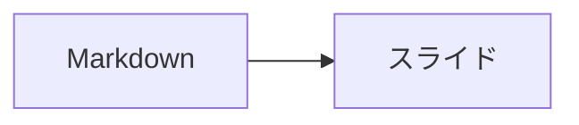

# 構文仕様 v0.1（ドラフト）

> スライド用 Markdown の書き方を定める。全体設計は [設計プラン](./design.md)、
> 一通りの構文を使った例は [examples/demo.md](../examples/demo.md) を参照。
> 各機能をどのマイルストーン（M1〜M5）で実装するかは [設計プラン §14](./design.md#14-ロードマップ) に記載。

## 0. 原則

1. **普通のMarkdownだけで1本の資料が作れる。** CommonMark と GFM（表・タスクリスト・脚注・打ち消し線・`> [!NOTE]` 形式のアラート）はそのまま使える。
2. **追加構文は7種類だけ。** ①フロントマター ②`---` による区切り ③`{…}` 属性 ④`:::` コンテナ ⑤`. . .` ⑥フェンスコードの言語名による図の埋め込み ⑦単独行の指示 `::名前`（今は `::maketitle` のみ）。
3. **書くのは「意図」で、CSSの値は書かない。** 「横に並べる」「ここで区切る」「1枚にまとめる」を書けるようにし、px や色コードを書かなくても済むようにする。
4. **他のビューアで開いても内容が失われない。** GitHub などで開くと追加構文は文字として見えるが、本文はすべて読める（§10）。
5. **書き間違いは黙って無視しない。** 未知のキーや属性は警告し、近い候補を示す（例：「`lyout` は `layout` のことですか？」）。アプリのエディタでは、補完と構文ヒントで書き方を示す（[設計プラン §9.3](./design.md#93-入力の補助サジェストと構文ヒント)）。

## 早見表

| やりたいこと | 書き方 |
|---|---|
| タイトルスライドを置く | フロントマターに `title` などを書き、本文に `::maketitle` |
| ここでスライドを区切る | 空行を挟んで `---` |
| この節を1枚に収める | `## 見出し {keep}` |
| 一部をまとめて同じスライドに置く | `:::keep` … `:::` |
| 横に並べる | `:::row` … `:::` |
| 縦に並べる（自動の横並びをさせない） | `:::stack` … `:::` |
| レイアウトを指定する | `## 見出し {layout=split}` |
| 背景を画像・動画にする | `{bg}` |
| 画面の左半分・右半分を画像にする | `{bg=left}` |
| ここで一旦止める（段階表示） | `. . .` |
| 箇条書きを1項目ずつ出す | `:::steps` … `:::` |
| 要素を出す順番を指定する | 要素の末尾に `{step=2}` |
| 発表者ノート | `:::notes` … `:::` |
| 図を描く | ```` ```mermaid ```` |
| スライドを発表から外す | `## 見出し {hidden}` |

---

## 1. フロントマター

ファイル先頭の YAML。すべて任意で、書かなければアプリが決める。

```yaml
---
title: Markdownで作るスライド
subtitle: 書くことに集中するために
author: 山田 太郎
affiliation: ○○大学
date: today
event: 社内勉強会 #12
theme: clean
---
```

### 1.1 最初に用意するキー（MVP）

`title` から `logo` までの7つがタイトル情報で、`::maketitle`（§2.2）で表示する。

| キー | 値 | 既定 | 説明 |
|---|---|---|---|
| `title` | 文字列 | 先頭の H1 | タイトルスライドとブラウザのタイトルに使う |
| `subtitle` | 文字列 | — | |
| `author` | 文字列 / 配列 / `{name, affiliation}` の配列 | — | 著者ごとに所属が違う場合はオブジェクトの配列で書く |
| `affiliation` | 文字列 | — | 全員に共通の所属（`author` が文字列か文字列の配列のとき） |
| `date` | 日付 / `today` / 任意の文字列 | — | 日付は `lang` に合わせて整形する。それ以外の文字列はそのまま表示する |
| `event` | 文字列 | — | 発表の場（勉強会名・学会名など） |
| `logo` | パス | — | タイトルスライドに表示するロゴ |
| `theme` | `clean` / `dark` / `bold` | `clean` | |
| `aspect` | `16:9` / `4:3` / `16:10` | `16:9` | 論理サイズはそれぞれ 1280×720 / 960×720 / 1280×800 |
| `lang` | 言語タグ | `ja` | 改行規則とフォントの選択に使う |
| `slideLevel` | `auto` / `1` / `2` / `3` | `auto` | スライドを始める見出しのレベル（§2.1） |
| `split` | `auto` / `manual` | `auto` | `manual` では `---` と見出しでだけ区切る（あふれた分は縮小で収める） |
| `titleSlide` | `auto` / `false` | `auto` | `::maketitle` が無いときに、先頭にタイトルスライドを自動で作るか（§2.2） |
| `paginate` | 真偽値 | `true` | ページ番号を表示するか |
| `footer` | 文字列 | — | 全スライド共通のフッター |
| `accent` | 色 | テーマ依存 | アクセントカラーだけを差し替える |
| `css` | パス | — | カスタムCSS（上級者向け） |

### 1.2 後から追加する予定のキー

`toc`（目次スライド）、`breadcrumb`（章名の表示）、`continuation`（続きスライドの見出し表示）、`fit`（あふれたときの方針）、`transition`、`fonts`、`colors`（配色一式）、`background`（全スライドの既定背景）、`math`、`mermaid`、`code`、`pdf`、`html`（生HTMLを許可するか）。

---

## 2. スライドの区切り

### 2.1 見出しによる区切り

`slideLevel` のレベルの見出しが「節」を始め、1つの節は1枚以上のスライドになる。

| 見出しのレベル | 扱い |
|---|---|
| `slideLevel` より浅い（例：`#`） | 章扉スライド（`section` レイアウト） |
| `slideLevel` と同じ（例：`##`） | 新しい節を始める。見出しがスライドのタイトルになる |
| `slideLevel` より深い（例：`###`） | スライド内の小見出し。自動分割では最も区切りやすい位置になる |

`slideLevel: auto` のときは、「子の見出しを持たず、直後に本文（見出し以外）が続く見出し」の中で最も浅いレベルを選ぶ。Pandoc の規則（直後に本文が続く見出しの中で最も浅いレベル）を、章の導入文があっても崩れないように変えたもの。また、文書の先頭にあって唯一の H1 は資料タイトルとみなし、判定に含めない。

`slideLevel` より浅い見出しの直後にある本文（章の導入文）は、章扉スライドに一緒に表示する。章扉に収まらないほど長い場合は、章扉の次のスライドに置く。

よくある `#` タイトル → `##` 節 → `###` 小見出し という構成の文書は、自動的に `slideLevel = 2` になる。

最初の見出しより前に書いた本文は、見出しのない節として扱う（タイトルスライドの前に置く一言など）。

### 2.2 タイトルスライド（`::maketitle`）

LaTeX の `\maketitle` と同じ考え方で、タイトル情報はフロントマター（LaTeX のプリアンブルに当たる）に書き、本文の `::maketitle` の位置にタイトルスライドを置く。

```markdown
---
title: Markdownで作るスライド
subtitle: PowerPointにうんざりしたので
author:
  - name: 山田 太郎
    affiliation: ○○大学
  - name: 佐藤 花子
    affiliation: △△株式会社
date: 2026-11-16
event: 社内勉強会 #12
logo: ./assets/logo.svg
---

::maketitle
```

- **表示する項目**：`title`・`subtitle`・`author`（と所属）・`date`・`event`・`logo`。書かれていない項目は表示しない（LaTeX で `\date{}` を空にするのと同じ）。
- **著者と所属**：著者によって所属が違う場合は、著者名に番号を付けて所属を番号付きで並べる（LaTeX の authblk と同じ形式）。全員同じなら所属は1回だけ表示する。
- **日付**：`date: 2026-11-16` や `today` は `lang` に合わせて整形する（`ja` なら「2026年11月16日」）。「2026年 秋」のような文字列はそのまま表示する。
- **属性**：`::maketitle{variant=left}` のように付ける。`variant` は `center`（中央揃え、既定）か `left`（左揃え）。`.クラス名` と `hidden` も使える。
- **背景や補足を加える**：コンテナとして書く。中の画像に付けた `{bg}` / `{bg=left}` / `{bg=right}` は背景になり、文章はタイトル情報の下に小さく表示する。`:::notes` を入れれば発表者ノートになる（入れ子になるので、外側は `::::maketitle` とコロンを4つにする）。

  ```markdown
  :::maketitle {variant=left}
  {bg=right}

  資料: https://example.com/slides
  :::
  ```

- **独立した1枚**：`::maketitle` は必ず1枚を単独で占める。節の途中に書いた場合は、そこで節を区切る（`---` と同じ扱い）。何度書いてもよい（例：最後にもう一度タイトルを出す）。
- **自動生成**：文書のどこにも `::maketitle` がなく、`titleSlide: auto`（既定）の場合：
  - `title` があれば、先頭に `::maketitle` があるものとして扱う。
  - `title` がなければ、先頭にある唯一の H1 をタイトル、その直後の短い段落を副題としてタイトルスライドを作る。
  - `titleSlide: false` なら自動では作らない。`::maketitle` を明示した場合は、`titleSlide` の値に関係なく作る。
- **重複の防止**：`title` と先頭の H1 が同じ文言なら、その H1 は別のスライドにしない。
- **警告**：`::maketitle` があるのに `title` がない場合。

### 2.3 `---` による強制区切り

```markdown
前のスライドの内容

---

次のスライドの内容
```

- `---` の前には**必ず空行を入れる**。空行がないと、直前の行が見出しとして扱われる（Markdown の仕様）。エディタはこの書き方を警告する。
- `---` のあとに見出しがなければ、同じ節の続きのスライドになり、自動分割と同じように節の見出しを引き継ぐ。エディタの「ここで区切りを固定」は `---` を挿入する操作なので、区切りを固定しても見た目は変わらない。
- 引き継いだ見出しは、タイトル領域のあるレイアウト（`stack` `split` `columns` `grid`）でだけ表示する。`statement` と `media` では表示しない。
- `***` と `___` はスライドを区切らず、スライド内の水平線になる。

### 2.4 自動分割（`split: auto`）

内容が1枚に収まらないときだけ、節の中で分割する。

- **区切りやすい順**：小見出しの直前 ＞ 段落と段落の間 ＞ 箇条書きの項目の間 ＞ 表の行の間（見出し行は次のスライドにも出す） ＞ コードの空行
- **区切らない場所**：小見出しの直後、画像とキャプションの間、「：」で終わる文とその直後のリストやコードの間、`:::keep` の中、`. . .` でつながった範囲
- **あふれたときの順序**：①別のレイアウト（2段組など）で収まるか試す → ②最大 85% まで縮小 → ③分割
- 続きのスライドには元の見出しが付く。小見出しの途中で区切った場合は、小見出しも先頭に再掲する。

### 2.5 1枚にまとめる

```markdown
## 比較表 {keep}

（この節は分割しない。収まらなければ縮小する）
```

節の一部だけをまとめるときは `:::keep` で囲む。`:::keep` の中に `##` を複数書くと、それらの節を同じ1枚に置ける（2つ目以降の見出しは小見出しとして表示する）。最大 60% まで縮小し、それでも収まらなければ警告を出す。

---

## 3. 属性 `{…}`

### 3.1 書式

```text
{key=value key .class #id}
```

- 空白区切り。値に空白を含むときは `"…"` で囲む。
- **既知のキー・クラス・ID だけで構成された `{…}` だけを属性とみなす。** それ以外の `{…}` は文字のまま表示する。文中の `{name}` のような文字列が誤って属性になるのを防ぐため。
- 文字のまま表示した `{…}` のうち、`=` を含むものや、既知のキーに似ているもの（編集距離2以下）は書き間違いとみなして警告する。`{name}` のような普通の文章は警告しない。
- 文字として `{` を書きたいときは `\{` とする。

### 3.2 書く場所と適用先

| 書く場所 | 適用先 |
|---|---|
| 見出し行の末尾 `## 見出し {layout=split}` | その節から作られるスライド |
| 単独の行 `{layout=media}` | それを含むスライド（見出しのないスライド用） |
| 段落の末尾 `本文です。 {step}` | その段落 |
| 画像の直後（空白なし） `{width=40%}` | その画像 |
| リスト項目の末尾 `- 項目 {step=2}` | その項目 |
| フェンスコードの情報文字列 ```` ```mermaid {step} ```` | そのブロック |
| コンテナの開始行 `:::row {ratio=2:1}` | そのコンテナ |

### 3.3 スライドに付けるキー

| キー | 値 | 説明 |
|---|---|---|
| `layout` | `title` `section` `stack` `split` `columns` `grid` `media` `statement` | レイアウトを指定する（§3.5） |
| `keep` | — | 分割せず1枚に収める |
| `ratio` | `3:2` など | `split` と `columns` の幅の比。表示される順（左：右）で書く |
| `media` | `left` / `right` | `split` でメディアを置く側（既定は `right`） |
| `align` | `top` / `center` | 縦方向の揃え |
| `hidden` | — | 発表と書き出しから外す（エディタには表示する） |
| `.クラス名` | — | テーマやカスタムCSSのクラスを付ける |

### 3.4 要素に付けるキー

| キー | 対象 | 説明 |
|---|---|---|
| `step` / `step=N` | すべて | 段階的に表示する（§5） |
| `bg` / `bg=left` / `bg=right` | 画像・動画 | 背景にする（§6.2） |
| `fit=cover` / `fit=contain` | 画像・動画 | 枠に対する収め方 |
| `pos=top` / `pos=top-left` / `pos="30% 20%"` | 画像・動画 | 切り取る・収めるときに残す位置（§6.2） |
| `fill=blur` / `fill=black` | 背景 | 収めたときの帯の埋め方。`blur` はぼかした同じ画像（§6.2） |
| `dim=0〜1` | 背景 | 背景を暗くして文字を読みやすくする |
| `blur=数値` | 背景 | 背景をぼかす |
| `width=40%` | 画像・動画・図 | 幅を固定する（既定は空いている領域いっぱい） |
| `autoplay` `loop` `muted` `controls` | 動画 | 再生方法 |
| `poster=パス` | 動画 | PDF と読み込み中に表示する静止画 |
| `caption="…"` | 画像・動画・図 | キャプション |

### 3.5 レイアウトの種類

通常は自動で選ばれる。合わないときだけ `layout=` で指定する。

| 名前 | 見た目 |
|---|---|
| `title` | タイトル・副題・著者・日付 |
| `section` | 章扉。大きな見出し（＋短い導入文） |
| `stack` | 見出しの下に内容を縦に積む（既定） |
| `split` | 見出しの下を2列に分け、本文とメディア（画像・動画・図・コード）を並べる |
| `columns` | 見出しの下に2〜4列のカードを並べる |
| `grid` | 画像を格子状に並べる |
| `media` | 画像・動画・図を全面に表示し、キャプションを重ねる |
| `statement` | 一文や引用を中央に大きく表示する |

---

## 4. コンテナ `:::`

```markdown
:::名前 {属性}
中身（普通のMarkdown）
:::
```

入れ子にするときは、外側のコロンを増やす（`::::row` … `::::`）。

閉じる `:::` がないまま文書が終わった場合は、開始位置の次にある `slideLevel` 以上の見出しの直前で閉じたものとして扱い、警告する。書き忘れ1つで、それより後ろのスライドがすべて崩れるのを防ぐため。

| コンテナ | 役割 |
|---|---|
| `:::row` | 中身を横に並べる |
| `:::stack` | 中身を縦に並べる。自動レイアウトに横並びにさせたくないとき、または `:::row` の1列に複数のブロックを入れるときに使う |
| `:::keep` | 中身を同じスライドに置く（§2.5） |
| `:::steps` | 中身を1つずつ表示する（§5） |
| `:::notes` | 発表者ノート（§8） |
| `:::maketitle` | 背景や補足を加えたタイトルスライド（§2.2） |

### 4.1 `:::row` の列の分け方

1. 中に見出しがあれば、見出しごとに1列（見出しから次の同レベルの見出しの直前まで）
2. 見出しがなければ、トップレベルのブロックごとに1列
3. 画像だけを並べた段落は、画像1枚ごとに1列
4. 複数のブロックを1列にまとめたいときは `:::stack` で囲む

```markdown
:::row {ratio=3:2}
### 課題
- 操作が多い
- デザイン調整が大変

### 解決
- Markdownを書くだけ
- テーマを選ぶだけ
:::
```

```markdown
:::row


:::
```

GitHub形式のアラート（`> [!NOTE]`、`> [!TIP]`、`> [!WARNING]` など）は、テーマに合わせた囲み枠として表示する。追加構文は不要。

---

## 5. 段階的表示

### 5.1 `. . .` — ここで一旦止める

前後に空行を入れた単独行に `. . .`（ピリオドと空白を交互に3つ）を書くと、そこまでが1ステップになる。

```markdown
## クイズ

1 + 1 は？

. . .

答えは **2** です。
```

- コンテナの中に書けば、そのコンテナ内で区切る（例：`:::row` の中なら列を1つずつ出す）。
- `. . .` でつながった範囲は同じスライドに保つ（自動分割の対象外）。

### 5.2 `:::steps` — 1つずつ表示する

```markdown
:::steps
- 理由1
- 理由2
- 理由3
:::
```

リストはトップレベルの項目ごとに、それ以外はブロックごとに1ステップ。

### 5.3 `{step}` / `{step=N}` — 要素ごとに指定する

```markdown
{step}

答えの説明です。 {step=3}
```

- `{step}` は文書順で次の番号を自動で割り当てる。`{step=N}` は番号を固定し、同じ番号の要素は同時に表示する。
- `. . .`・`:::steps`・`{step}` の自動の番号は、スライド内を文書順にたどって「それまでに使われた最大の番号＋1」を割り当てる。`{step=N}` の明示番号はそのまま使う。例：`{step}` → 1、`{step=3}` → 3、`{step}` → 4。
- 番号に欠けがある場合は詰める（例：1・3・4 は 1・2・3 として扱う）。意味を持つのは表示の順番だけで、何も出ない操作は作らない。
- 自動分割で1つの節が複数のスライドに分かれた場合、ステップはスライドごとに 1 から数え直す（前のスライドをすべて出してから次のスライドに進む）。`{step=N}` の明示の番号の順番が崩れる位置（区切りの前に、区切りの後と同じか大きい番号がある位置）では分割しない。
- 表示効果の既定はフェード（効果の種類の追加は M4）。

### 5.4 図・コードの内部ステップ（M4）

埋め込んだ図が内部に段階を持つ場合（[動く構成図](./arch-diagram.md)のシナリオなど）や、コードの行ハイライトを指定した場合は、その要素の位置でスライドのステップ列に組み込む。

````markdown
```ts {lines="1|2-3|5"}
const a = 1;
const b = 2;
const c = a + b;

console.log(c);
```
````

### 5.5 PDF での扱い

既定ではすべてを表示した状態を1ページにする。`pdf: { steps: each }` を指定すると、ステップごとに別のページへ展開する。

---

## 6. 画像・動画・背景

### 6.1 本文中

```markdown

{autoplay loop muted}

```

- `"…"` のタイトルはキャプションになる。`caption="…"` を付けた場合はそちらを使う。
- 拡張子が `mp4` / `webm` / `mov` なら動画として扱う。YouTube / Vimeo の URL は埋め込みプレイヤーになる。
- 動画に `autoplay` も `controls` も付けなければ、操作ボタンを出す（再生できなくならないように）。
- 画像・動画・図は既定で「空いている領域いっぱいに、縦横比を保って」表示する。`width=` で固定できる。
- 画像・動画だけからなる段落は、横に並べる（1行に書いても、改行して書いても同じ）。文の中の画像は、文字と一緒にそのまま並ぶ。
- 代替テキストがない画像・動画は警告する（背景は飾りなので警告しない）。
- 手元のファイルが見つからない場合は警告し、スライドには枠だけを表示する。

### 6.2 背景

```markdown
{bg dim=0.4}
{bg}
{bg=left}
```

- `{bg}` は全面の背景、`{bg=left}` / `{bg=right}` は画面の半分を画像・動画にし、残り半分に本文を置く。
- スライド内のどこに書いても、そのスライドの背景になる。
- 背景がある場合、テーマは文字色と影を「画像上」用に切り替える。全面の背景では、背景の明るさ（`dim=` で暗くした後）から、明るい文字か暗い文字かを選ぶ。明るさは CLI がブラウザで測る。測れないときは、少し暗くして（`dim=0.35`）明るい文字にする。
- 自動分割で節が複数のスライドに分かれた場合、続きのスライドにも同じ背景を使う。

**縦横比がスライドと違う画像・動画**は、歪めずに次のどれかで表示する。

```markdown
{bg}                  ← 既定：拡大して全面を埋める（はみ出した分は中央を基準に切る）
{bg pos=top}          ← 切るときに上を残す
{bg fit=contain}      ← 全体を収める（帯は黒）
{bg fill=blur}        ← 全体を収め、帯をぼかした同じ画像で埋める
```

| 書き方 | 向いている場面 |
|---|---|
| `{bg}`（既定） | 写真の端が切れてもよい、雰囲気づくりの背景 |
| `{bg pos=…}` | 人物の顔など、残したい部分が中央にない写真 |
| `{bg fit=contain}` | 図やスクリーンショットなど、全体を見せたいもの |
| `{bg fill=blur}` | 全体を見せたいが、黒い帯は避けたいもの |

- `pos=` は `top` / `bottom` / `left` / `right` / `center` の1方向か、`top-left` / `top-right` / `bottom-left` / `bottom-right` の2方向。細かく決めたいときは `pos="30% 20%"`（横・縦の割合）と書く。本文の画像・動画の `fit=cover` にも使える。
- `fill=blur` を付けると `fit=contain` になる（帯ができるのは収めたときだけなので）。`fill=black` は既定の黒い帯。動画では、ぼかした同じ動画を後ろに重ねる。
- 背景そのものをぼかす `blur=` とは別の指定。
- スライドの縦横比は資料全体で1つ（フロントマターの `aspect:`）なので、画像に合わせてスライドの縦横比を変えることはしない。

---

## 7. 図表の埋め込み

### 7.1 コードブロックで書く

````markdown

````

| 言語名 | 形式 | 時期 |
|---|---|---|
| `mermaid` | Mermaid | M3 |
| `arch` | 動く構成図（[仕様](./arch-diagram.md)） | M4 |
| `math` または `$$…$$` | 数式（KaTeX）。文中では `$…$` | M3 |
| `vega-lite` | グラフ | 将来 |
| `dot` | Graphviz | 将来 |

### 7.2 ファイルを参照する

```markdown

```

拡張子（`.mmd`、`.arch` など）で形式を判断する。属性は画像と同じように付けられる。

---

## 8. 発表者ノート

```markdown
:::notes
ここで会場に質問する。
:::
```

- ノートは、直前の内容があるスライドに付く。節が自動分割された場合も、書いた位置に対応するスライドに付く。
- HTMLコメント `<!-- … -->` は単なるコメントとして無視する（ノートにはならない）。

---

## 9. 生HTML

Markdown 内の生HTMLはそのまま出力する（資料の作者を信頼する前提）。エディタのプレビューは隔離した iframe で表示するため、生HTMLからエディタやファイルにはアクセスできない。`html: false` で無効にできる（M3）。

---

## 10. 他のMarkdownビューアでの見え方

| 構文 | GitHub などでの表示 |
|---|---|
| フロントマター | 表として表示される、または非表示 |
| `---` | 水平線 |
| `{…}` | 文字としてそのまま見える |
| `:::名前` | 文字として見える（中身は普通に表示される） |
| `::maketitle` | 文字として見える（タイトル情報はフロントマターの表に出る） |
| `. . .` | 「. . .」という段落 |
| ```` ```mermaid ```` | GitHub では図として表示される |

どれも本文の情報は失われない。

---

## 11. 予約している構文

- 単独行の指示 `::名前{…}` は、今は `::maketitle` だけを定義している。ほかの名前は将来の拡張用に予約する（例：`::toc` で目次）。
- 文中の指示 `:名前[…]{…}` も将来の拡張用に予約する（例：`:icon[github]` でアイコン）。

## 12. 採用しなかった案

| 案 | 理由 |
|---|---|
| `<!-- pause -->` で止める | 他のビューアで見えない点は良いが、書く量が多い。`. . .` は Pandoc と同じ書き方で短い |
| `+` で始めた箇条書きを1つずつ表示 | Prettier などの整形で `-` に置き換わると意味が消える |
| Marp の `<!-- _class: … -->` 形式の指定 | コメントの中に設定を書くと、書き間違いに気付きにくい |
| 列の区切りを `\|\|\|` などの記号で書く | 記号を覚える必要がある。見出し単位で列を分けるほうが文書として自然 |
