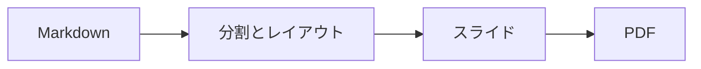

<!--
  構文仕様 v0.1（docs/syntax.md）の構文を一通り使ったサンプル。
  画像・動画は未同梱。実装後はゴールデンテストの入力としても使う。
  frontmatter に title があるので、1枚目のタイトルスライドは自動で作られる。
  見出しの構成（# 章 → ## 節）から slideLevel は自動で 2 になる。
-->

# はじめに

## なぜ作るのか

PowerPoint は高機能だが、ちょっとした発表資料を作るには重い。

- 操作が多い
- デザインの調整に時間がかかる
- テキストで差分を管理できない
- 同じ見た目を保つのが難しい

> [!NOTE]
> 書くことに集中できる道具が欲しい。

## 目指すもの {layout=split}

Markdown を書くだけで、区切り・配置・デザインはアプリが決める。

- CSS は書かない
- 必要なときだけ希望を伝える

# 使い方

## 書き方の基本

ここに長い説明が続くと、内容があふれた時点で自動的に次のスライドへ分割される。
分割された続きのスライドにも「書き方の基本」という見出しが引き継がれる。

### 見出しで区切る

`##` が新しい節、`###` はスライド内の小見出しになる。
小見出しの直前は、自動分割で最も区切りやすい位置になる。

### 明示的に区切る

空行を挟んで `---` を書くと、そこで必ずスライドが変わる。

### まとめる

`{keep}` や `:::keep` を使うと、内容を1枚に収める。

## 比較

:::row
### Before
- レイアウトを手作業で調整
- スライドを複製して段階表示

### After
- 自動レイアウト
- `. . .` で段階表示
:::

## クイズ

1 + 1 は？

. . .

答えは **2** です。

## 理由は3つ

:::steps
- 手軽に書ける
- 速く作れる
- 綺麗に仕上がる
:::

:::notes
1項目ずつ出しながら、それぞれに具体例を添えて話す。
:::

## 仕組み

## デモ動画

{autoplay loop muted}

## 写真と一言

{bg=left}

道具は、使う人が意識しなくなったときに完成する。

---

<!-- 見出しのないスライド。statement レイアウトなので、引き継いだ節の見出しは表示されない -->

{bg dim=0.5}

{layout=statement}

ご清聴ありがとうございました
