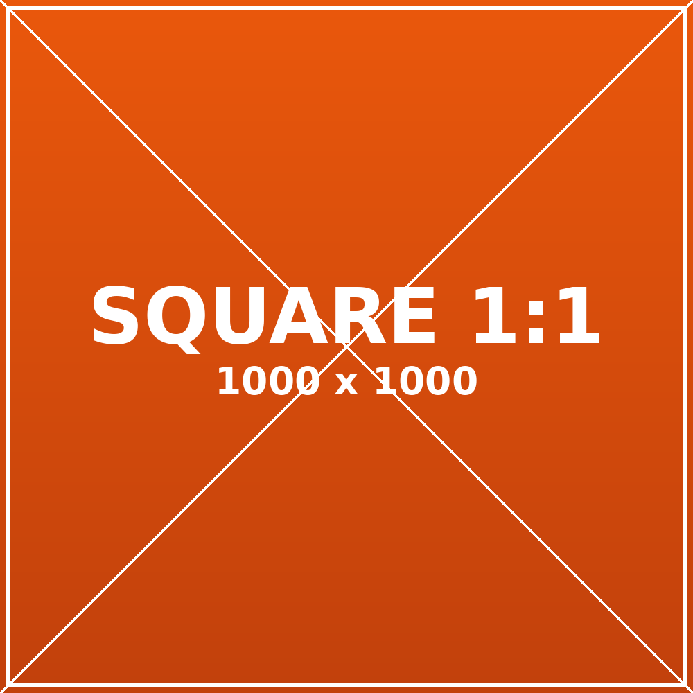
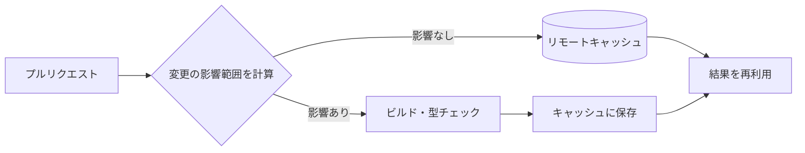
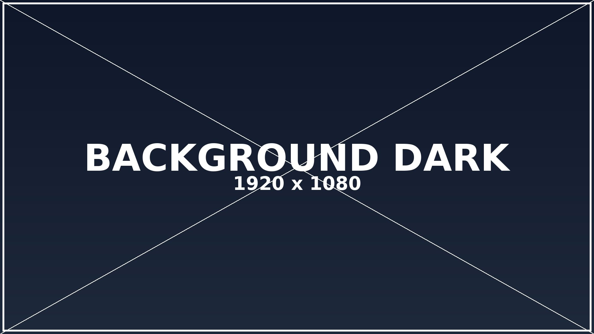

:::maketitle {variant=left}
{bg=right}

資料: https://example.com/slides/ci-cache
:::

## 自己紹介 {layout=split}



- 山田 太郎
- 開発基盤チームで CI と開発環境を担当
- 好きなコマンドは `git bisect`

## 今日の話

1. 何が遅かったのか
2. どう測ったのか
3. 何を変えたのか
4. 結果と残った課題

# 何が遅かったのか

## 状況

- パッケージ数：48
- 1回の CI：平均 **23分**
- 1日の CI 実行：約 300 回

. . .

> 1日に **115時間** 分、CI を待っている計算になる。

:::notes
ここで一呼吸おく。数字のインパクトを伝える。
:::

## クイズ

一番時間がかかっていた工程はどれでしょう？

:::row
**A.** 依存関係のインストール

**B.** 型チェック

**C.** テスト

**D.** Docker イメージのビルド
:::

. . .

正解は **B. 型チェック**。全体の 41% を占めていた。

# どう測ったのか

## 工程ごとの所要時間

| 工程 | 所要時間 | 割合 |
|---|---:|---:|
| 依存関係のインストール | 3分10秒 | 14% |
| 型チェック | 9分25秒 | 41% |
| テスト | 6分05秒 | 26% |
| Docker ビルド | 3分20秒 | 15% |
| その他 | 1分00秒 | 4% |

## 計測に使ったスクリプト

各工程の開始と終了で時刻を記録し、ジョブの最後にまとめて送信する。

```ts
// scripts/trace.ts
import { performance } from "node:perf_hooks";

const marks: Record<string, number> = {};

export function start(name: string) {
  marks[name] = performance.now();
}

export function end(name: string) {
  const ms = performance.now() - marks[name];
  console.log(`::notice::${name} ${(ms / 1000).toFixed(1)}s`);
  return ms;
}
```

# 何を変えたのか

## 変更の全体像



## やったこと

:::steps
- 影響を受けるパッケージだけをビルドする
- 型チェックの結果をリモートキャッシュに保存する
- テストをパッケージ単位で並列に実行する
- Docker のレイヤー順を見直す
:::

## 型チェックのキャッシュ

TypeScript の `incremental` と `tsBuildInfoFile` を使い、生成された情報をキャッシュに保存する。

```json
{
  "compilerOptions": {
    "composite": true,
    "incremental": true,
    "tsBuildInfoFile": "./.cache/tsbuildinfo.json"
  }
}
```

キャッシュのキーには、依存パッケージのソースのハッシュを含める。

## Before / After

:::row
### Before
- 全パッケージを毎回ビルド
- 型チェックは毎回ゼロから
- テストは直列実行
- 平均 **23分**

### After
- 影響のあるパッケージだけ
- 型チェックはキャッシュを再利用
- テストは8並列
- 平均 **2分20秒**
:::

# 結果と残った課題

## 結果 {layout=statement}

**23分 → 2分20秒**

## 残った課題

- キャッシュが壊れたときに気付きにくい
- 初回のビルドは速くならない
- キャッシュの保存容量が増え続ける

. . .

次は、キャッシュの検証を自動化する予定。

## まとめ

- まず測る。推測で直さない
- 影響範囲を絞ると、速くするより効果が大きい
- キャッシュは「壊れたときの検知」までセットで設計する

---

{bg dim=0.3}

{layout=statement}

ありがとうございました
