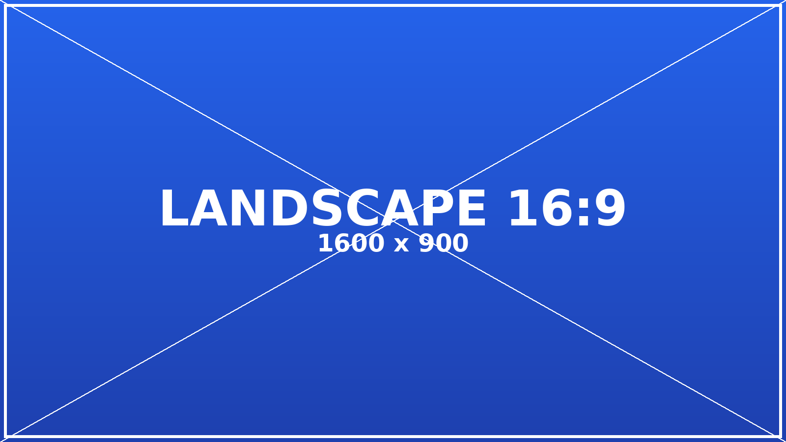
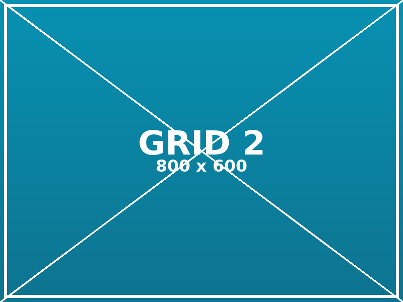
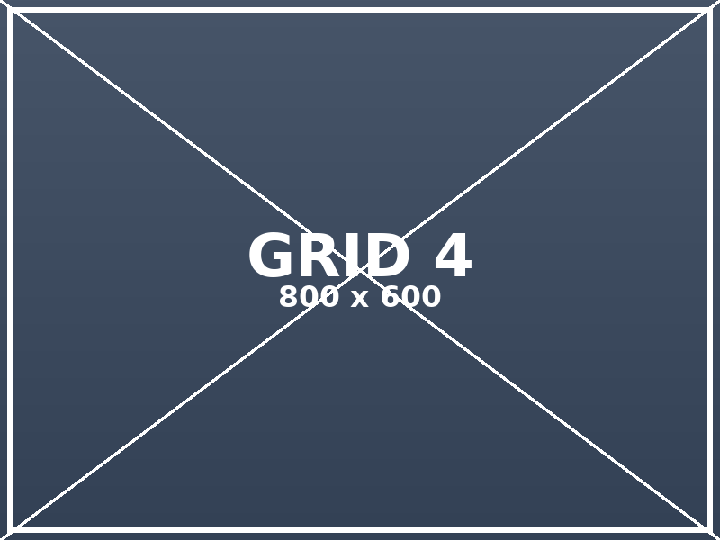
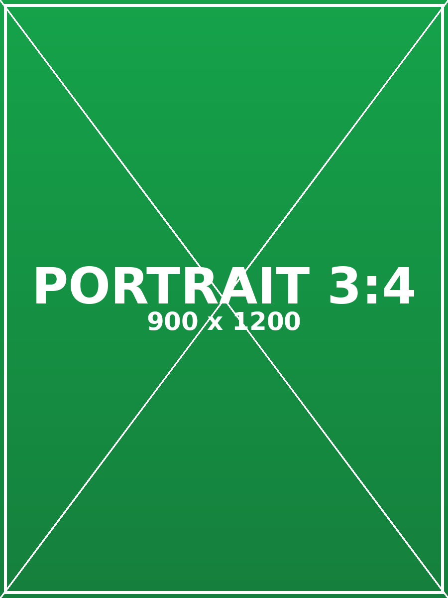
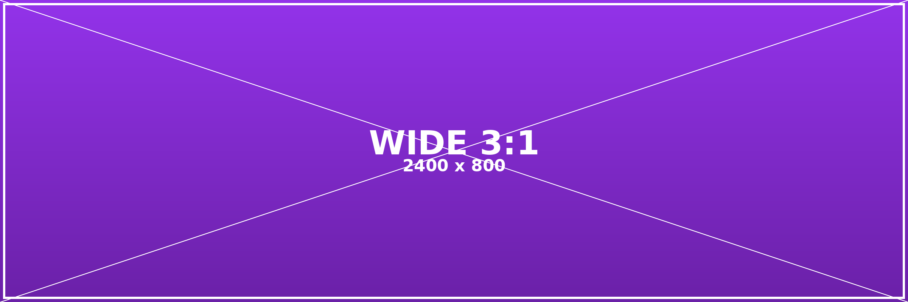

<!--
  各節の見出しに「期待するレイアウト」を書いている。
  レイアウトの指定（{layout=…}）は一切使っていない。すべて自動判定の結果を確かめる。
-->

## 一文だけ → statement

書くことに集中できる道具が欲しい。

## 引用だけ → statement

> 道具は、使う人が意識しなくなったときに完成する。

## 見出しだけ → section

## 横長の画像1枚 → media



## 図だけ → media


## 動画だけ → media

{autoplay loop muted}

## 画像4枚 → grid

4つの案を比べる。

   

## キャプション付きの画像3枚 → grid


## 文章と縦長の画像 → split（文章60：画像40）

スマートフォン向けの画面を新しくした。

- 1画面に表示する情報を減らした
- 主要な操作を親指の届く範囲に集めた
- 文字を大きくした



## 文章と横長の画像 → split（50：50）

管理画面のダッシュボードを作り直した。主要な数値が一目で分かるようにし、詳細は必要なときだけ開く形にした。


## 文章ととても横長の画像 → stack（画像は下）

1年間の利用者数の推移。春と秋に大きく伸びている。



## 文章と短いコード → split

関数は1つのことだけを行う。

```ts
function add(a: number, b: number) {
  return a + b;
}

const total = add(1, 2);
```

## 文章と長い行のコード → stack

設定ファイルを読み込んで、環境ごとに値を上書きする。

```ts
const config = mergeDeep(await loadYaml("./config/default.yaml"), await loadYaml(`./config/${process.env.NODE_ENV}.yaml`));
export const databaseUrl = config.database.url ?? throwMissingConfig("database.url is required in config/default.yaml");
```

## 文章と動画 → split

操作の流れを短い動画で紹介する。

- ファイルを開く
- 編集する
- 発表する

{controls}

## 分量の近い小見出し3つ → columns

### 速い

打鍵してから 50ms 以内にプレビューに反映する。

### 軽い

発表用のプレイヤーは 20KB 以下。

### 綺麗

テーマを選ぶだけで見た目が揃う。

## 分量の違う小見出し2つ → stack

### 概要

この機能は、Markdown の見出しの構造からスライドの区切りを自動で決める。見出しのレベルは文書ごとに判定し、内容が1枚に収まらない場合は、意味のまとまりを崩さない位置で分割する。分割したスライドには元の見出しを引き継ぐ。

### 補足

設定で無効にできる。

## 段落とリスト → stack

一般的な説明スライド。特別な要素はない。

- 1つ目の要点
- 2つ目の要点
- 3つ目の要点

最後に一言添える。

## 短い項目の多いリスト → stack（リストは2段組）

- りんご
- みかん
- ぶどう
- もも
- なし
- かき
- いちご
- メロン
- すいか
- バナナ
- キウイ
- レモン
- ゆず
- びわ

## 長い項目の多いリスト → stack（2段組にしない）

- 見出しのレベルから、スライドを始める見出しを自動で判定する
- 内容が1枚に収まらない場合は、意味のまとまりを崩さない位置で分割する
- 分割した続きのスライドには、元の見出しを引き継いで表示する
- 文章とメディアの組み合わせから、左右に並べるか上下に積むかを決める
- 画像や図は、空いている領域いっぱいに縦横比を保って表示する
- 利用者の指定は、Markdown の該当箇所に書くので文章の編集に追従する
- 書き間違えた属性やキーは、近い候補を添えて警告する
- 同じ入力からは、必ず同じスライドを出力する

## 表だけ → stack

| 項目 | 値 |
|---|---|
| スライド数 | 18 |
| レイアウトの種類 | 8 |
| 画像 | 12 |
