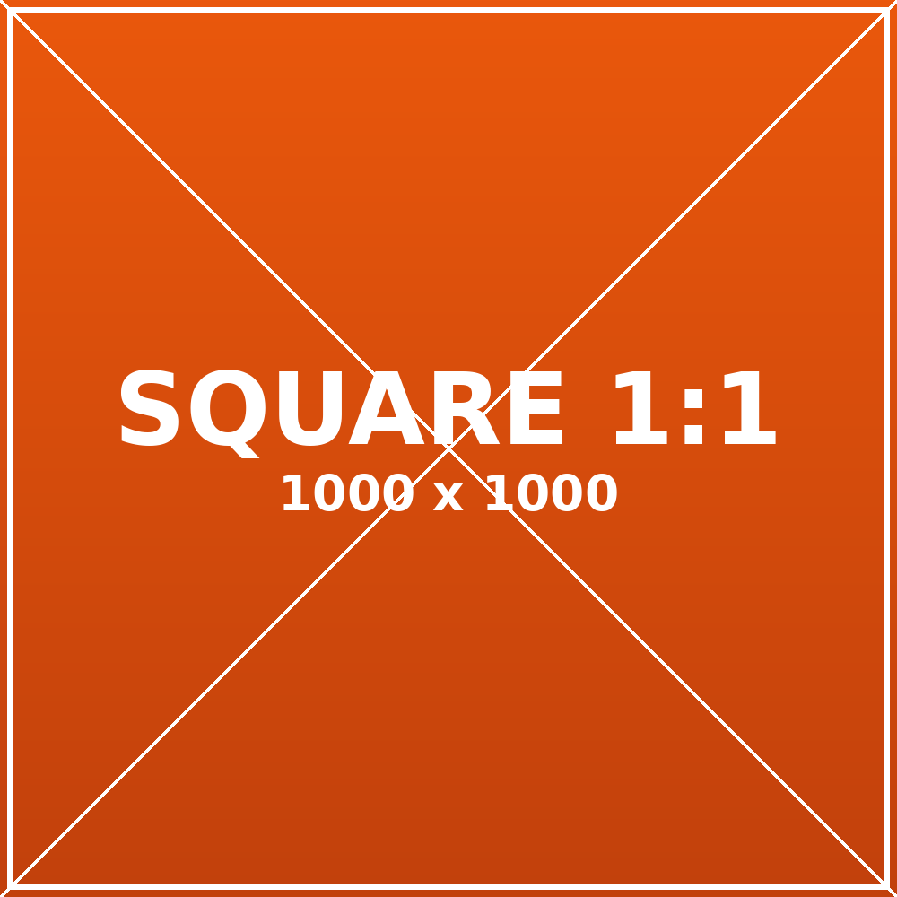
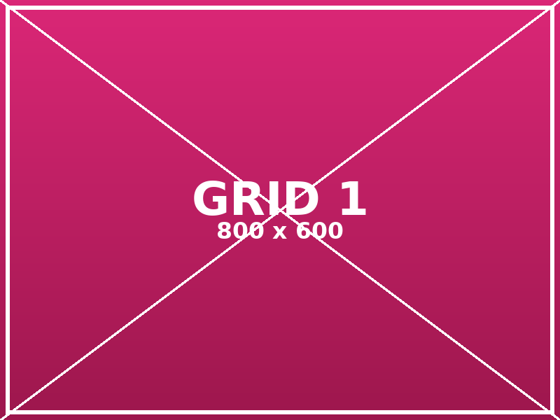
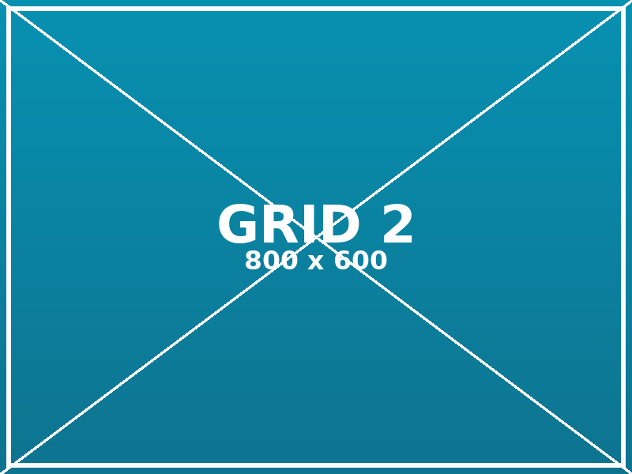
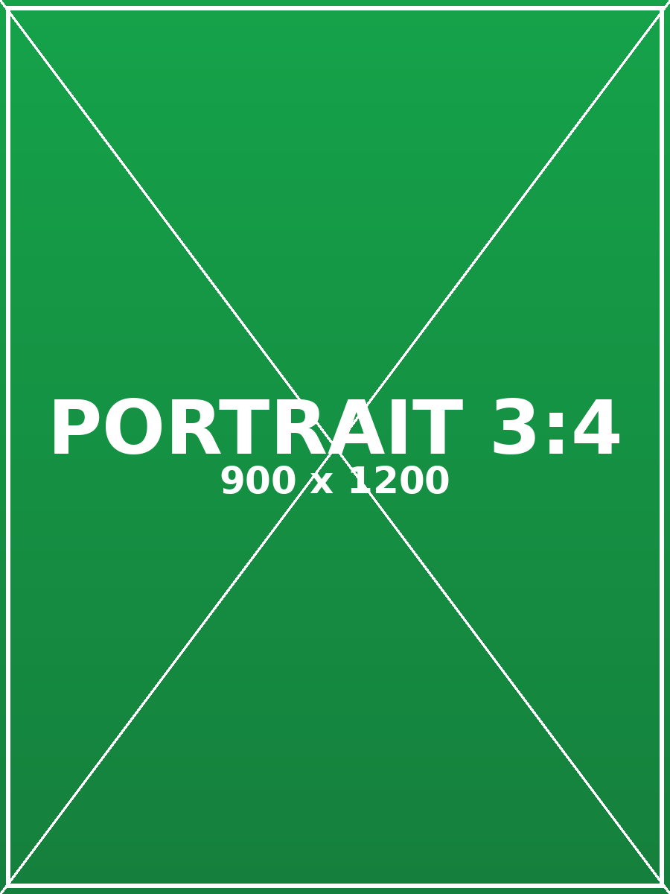
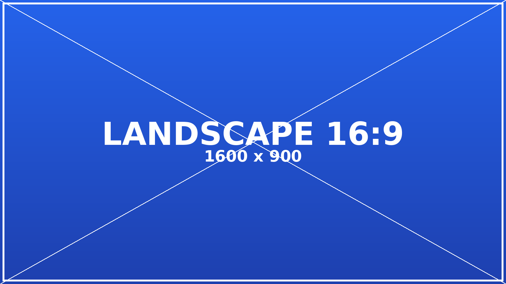
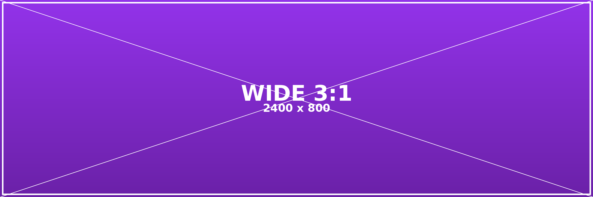

## --- で区切る

1枚目の内容。ここで区切りたいので、下に `---` を書いている。

---

2枚目の内容。見出しは書いていないが、「--- で区切る」を引き継いで表示する。

## 区切りの直後に見出しがある

`---` の直後に見出しが来る場合、空のスライドを作ってはいけない。

---

## 次の節

前の節の最後の `---` は、この節との区切りと重なる。

## 1枚に収める {keep}

本来は2枚に分かれる分量だが、`{keep}` を付けているので縮小して1枚に収める。

- 見出しのレベルから、スライドを始める見出しを自動で判定する
- 内容が1枚に収まらない場合は、意味のまとまりを崩さない位置で分割する
- 分割した続きのスライドには、元の見出しを引き継いで表示する
- 文章とメディアの組み合わせから、左右に並べるか上下に積むかを決める
- 画像や図は、空いている領域いっぱいに縦横比を保って表示する
- 利用者の指定は、Markdown の該当箇所に書くので文章の編集に追従する
- 書き間違えた属性やキーは、近い候補を添えて警告する
- 同じ入力からは、必ず同じスライドを出力する
- 編集の影響は、その節のスライドだけにとどまる
- 重い処理は、必要になったときだけ読み込む

最後の一文まで同じスライドに入る。

:::keep
## 2つの節を1枚に（前半）

前半の節の内容。

## 2つの節を1枚に（後半）

後半の節の内容。2つ目の見出しは小見出しとして表示する。
:::

## 一部だけまとめる

この段落は、下のまとまりとは別のスライドになってもよい。

:::keep
次の3つは必ず同じスライドに置く：

- 問題
- 原因
- 対策
:::

この段落も、上のまとまりとは別のスライドになってもよい。

## 比率を指定して横に並べる

:::row {ratio=2:1}
左の列は広い。文章を多めに書く。ここには説明を置き、右の列には画像を置く。比率を 2:1 に指定している。

:::

## 入れ子で横に並べる

::::row
:::stack
### プランA

安いが遅い。
:::

:::stack
### プランB

速いが高い。
:::
::::

## 縦に並べる

自動なら左右に並ぶ組み合わせ（文章＋縦長の画像）だが、`:::stack` で縦に並べる。

:::stack
スマートフォン向けの画面を新しくした。

:::

## レイアウトと比率を指定する {layout=split media=left ratio=2:3}

メディアを左に置き、比率を 2:3 にしている。

## 自動の判定を上書きする {layout=stack}

自動なら statement になる一文だが、stack を指定している。

## 発表しない {hidden}

このスライドはエディタのプレビューには出るが、発表と書き出しには出ない。

## クラスと揃え {.highlight align=center}

`.highlight` クラスを付け、縦方向を中央に揃えている。

## 画像の幅を固定する

{width=40%}

画像は空いている領域いっぱいに広がらず、幅 40% のまま表示する。

---

{layout=media}

