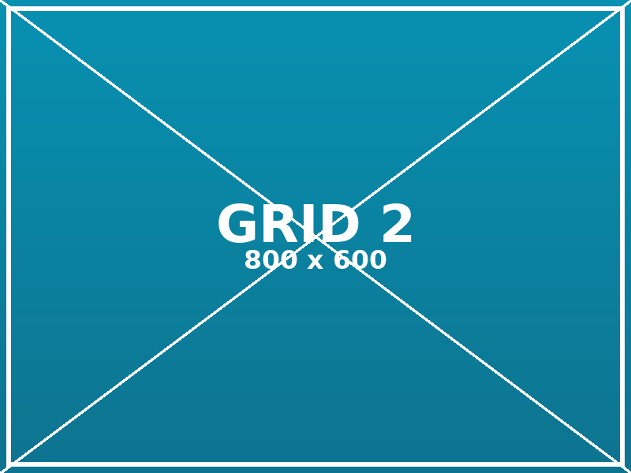
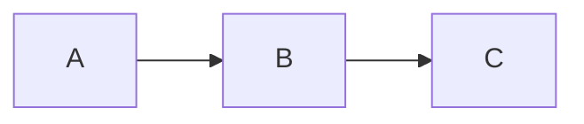

## . . . で区切る

1 + 1 は？

. . .

答えは **2** です。

. . .

では 2 + 2 は？

## :::steps でリストを1つずつ

:::steps
- 1つ目
- 2つ目
  - 入れ子の項目は親と一緒に出る
- 3つ目
:::

## :::steps でブロックを1つずつ

:::steps
最初の段落。


最後の段落。
:::

## {step} で要素ごとに指定

ここは最初から表示する。

この段落は1回目の操作で出る。 {step}

{step}

この段落は3回目の操作で出る。 {step}

## {step=N} で順番を指定

文書の順番とは逆に出す。

- 3番目に出る {step=3}
- 2番目に出る {step=2}
- 1番目に出る {step=1}

## 同じ番号は同時に出る

{step=1} {step=1}

両方の画像が同時に出たあと、この段落が出る。 {step=2}

## 自動の番号と明示の番号が混ざる

最初から表示する。

自動（1）。 {step}

明示（3）。 {step=3}

自動（4。それまでの最大の3＋1）。 {step}

## :::row の中で . . .

:::row
### 左

先に出る。

. . .

### 右

あとから出る。
:::

## 問題と答え（画像）


. . .


## 図にステップを付ける



図は1回目の操作で出る。

## コードの行ハイライト（M4）

```ts {lines="1|2-3|5"}
const a = 1;
const b = 2;
const c = a + b;

console.log(c);
```

## . . . の範囲は分割しない

分量が多く、本来なら2枚に分かれるが、`. . .` でつながっているので1枚に保つ（収まるまで縮小する。60% でも収まらなければ警告を出す）。

- 見出しのレベルから、スライドを始める見出しを自動で判定する
- 内容が1枚に収まらない場合は、意味のまとまりを崩さない位置で分割する
- 分割した続きのスライドには、元の見出しを引き継いで表示する
- 文章とメディアの組み合わせから、左右に並べるか上下に積むかを決める
- 画像や図は、空いている領域いっぱいに縦横比を保って表示する

. . .

- 利用者の指定は、Markdown の該当箇所に書くので文章の編集に追従する
- 書き間違えた属性やキーは、近い候補を添えて警告する
- 同じ入力からは、必ず同じスライドを出力する
- 編集の影響は、その節のスライドだけにとどまる
- 重い処理は、必要になったときだけ読み込む
- 発表用のプレイヤーは軽く保つ
- 書き出した HTML は単体で動く

## 段階表示のないスライド

普通に全部表示される。
