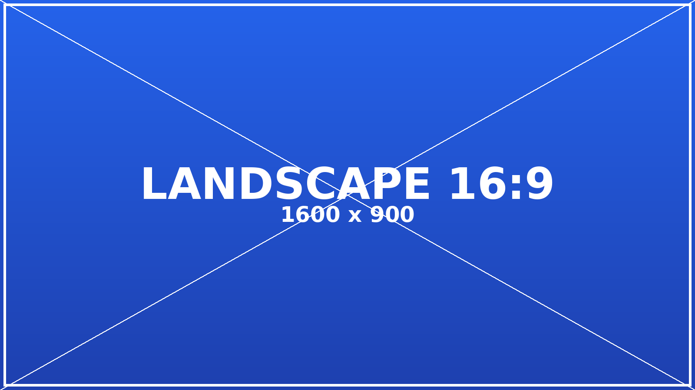
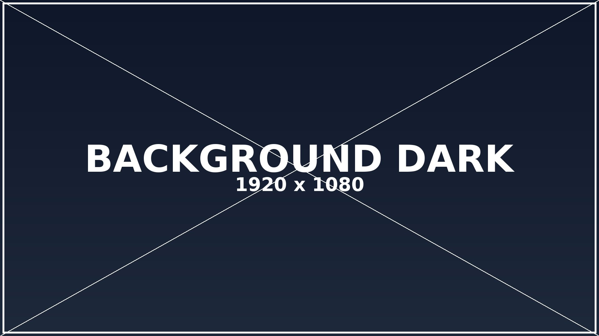
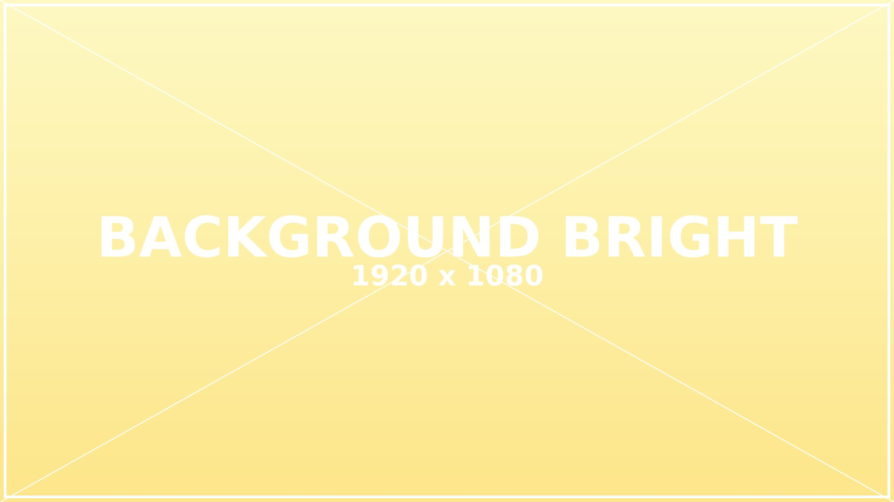
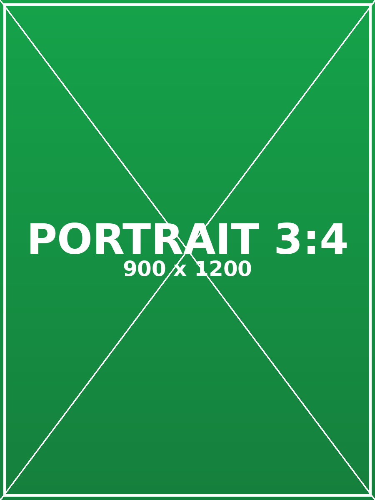
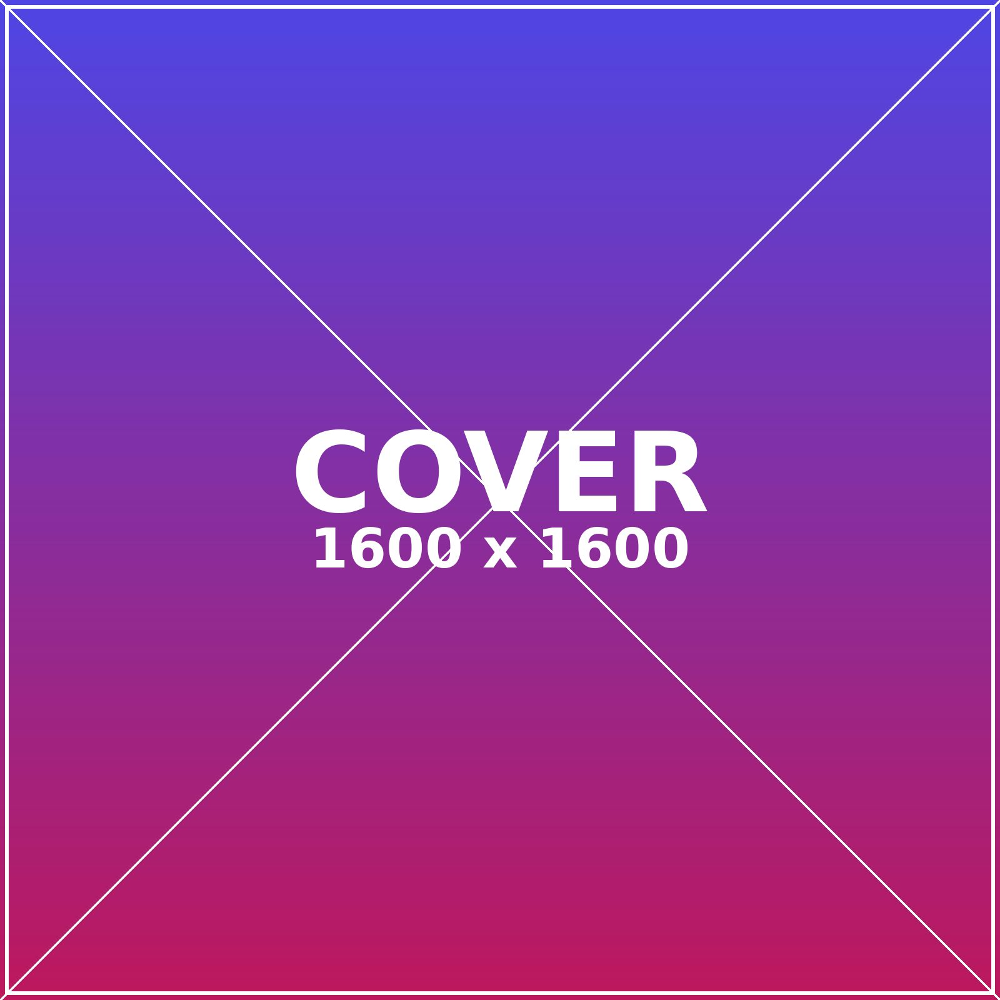
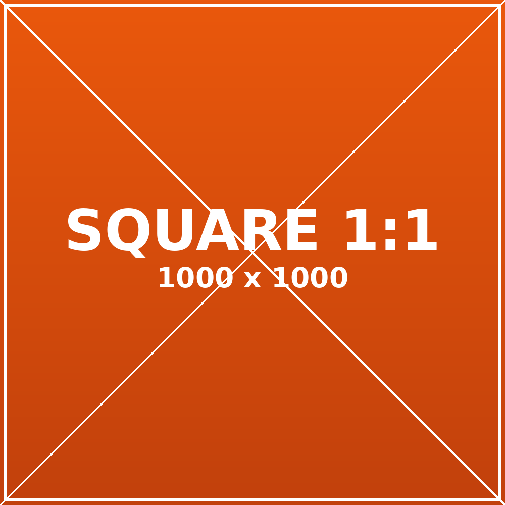

## キャプション付きの画像

## SVG の画像

SVG も通常の画像と同じように扱う。

## 動画（操作ボタンあり）

{controls poster=./assets/poster.jpg}

## 動画（自動再生・ループ・消音）

{autoplay loop muted}

## YouTube の埋め込み

PDF ではサムネイルとリンクになる。

## 全面の背景画像（暗い）

{bg}

背景が暗いので、文字は明るい色になる。

## 全面の背景画像（明るい）

{bg}

背景が明るいので、文字は暗い色になる。

## 背景を暗くする

{bg dim=0.6}

`dim=0.6` で暗くしたので、文字は明るい色になる。

## 背景をぼかす

{bg blur=8 dim=0.3}

`blur=8` でぼかしている。

## 背景を contain で収める

{bg fit=contain}

縦長の画像を、切り取らずに全体を表示する。

## 左半分を画像にする

{bg=left}

右半分に本文を置く。

- 項目1
- 項目2
- 項目3

## 右半分を画像にする

{bg=right}

左半分に本文を置く。

## 背景の動画

{bg dim=0.4}

背景の動画は自動で消音・ループ再生する。PDF では最初のフレームになる。

## 背景と内容の多いスライド

{bg dim=0.5}

背景があっても、自動分割と自動レイアウトは通常どおり行う。

- 見出しのレベルから、スライドを始める見出しを自動で判定する
- 内容が1枚に収まらない場合は、意味のまとまりを崩さない位置で分割する
- 分割した続きのスライドには、元の見出しを引き継いで表示する
- 文章とメディアの組み合わせから、左右に並べるか上下に積むかを決める
- 画像や図は、空いている領域いっぱいに縦横比を保って表示する
- 利用者の指定は、Markdown の該当箇所に書くので文章の編集に追従する
- 書き間違えた属性やキーは、近い候補を添えて警告する
- 同じ入力からは、必ず同じスライドを出力する
- 編集の影響は、その節のスライドだけにとどまる
- 重い処理は、必要になったときだけ読み込む

分割した場合は、続きのスライドにも同じ背景を使う。

## 代替テキストのない画像

エディタは「代替テキストがない」と警告する。

## 存在しない画像

エディタは「画像が見つからない」と警告し、スライドには枠だけを表示する。
