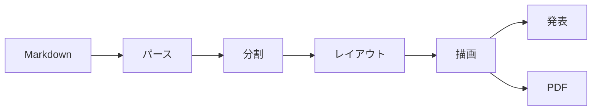
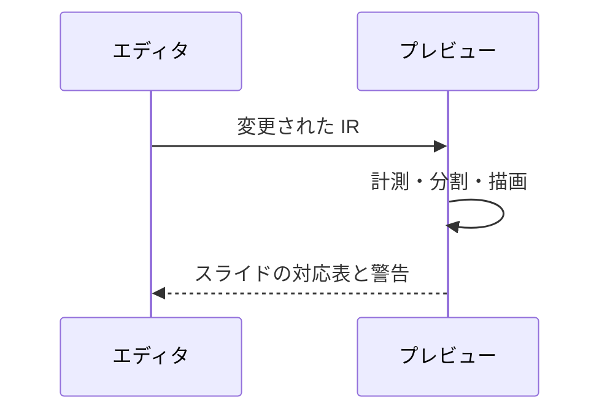
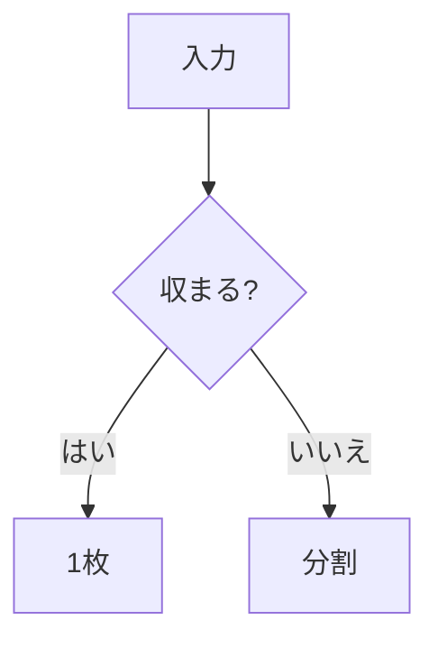
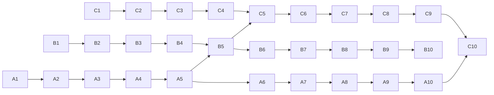

## Mermaid：フローチャート



## Mermaid：シーケンス図



## Mermaid：文章と並べる

処理の流れを図で示す。

- 入力は Markdown だけ
- 出力は HTML と PDF



## Mermaid：ファイルを参照する


## Mermaid：構文エラー

```mermaid
flowchart LR
  A --> 
  B -->> C
```

スライドにはエラーの枠を表示し、エディタには行番号付きで警告する。

## Mermaid：とても大きな図



図は領域に合わせて縮小する。分割はしない。

## 数式（M3）

二次方程式 $ax^2 + bx + c = 0$ の解は次のとおり。

$$
x = \frac{-b \pm \sqrt{b^2 - 4ac}}{2a}
$$

## コード：いくつかの言語

```python
def fib(n: int) -> int:
    a, b = 0, 1
    for _ in range(n):
        a, b = b, a + b
    return a
```

```rust
fn main() {
    let v: Vec<u32> = (1..=10).filter(|x| x % 2 == 0).collect();
    println!("{:?}", v);
}
```

## コード：言語名なし

```
言語名のないコードブロックは、ハイライトせずに等幅で表示する。
```

## コード：知らない言語名

```unknownlang
ハイライトできない言語名は、警告を出さずに等幅で表示する。
```

## コード：とても長いコード

```ts
// 1枚に収まらない長さのコードは、空行の位置で分割する。
import { readFile } from "node:fs/promises";

type Slide = { id: string; html: string };

export async function loadDeck(path: string) {
  const text = await readFile(path, "utf8");
  return parse(text);
}

function parse(text: string): Slide[] {
  const slides: Slide[] = [];
  let current: string[] = [];
  let index = 0;

  for (const line of text.split("\n")) {
    if (line.trim() === "---") {
      slides.push({ id: `s${index++}`, html: current.join("\n") });
      current = [];
      continue;
    }
    current.push(line);
  }

  if (current.length > 0) {
    slides.push({ id: `s${index++}`, html: current.join("\n") });
  }

  return slides;
}

export function countSlides(slides: Slide[]) {
  return slides.length;
}

export function findSlide(slides: Slide[], id: string) {
  return slides.find((slide) => slide.id === id);
}

export function firstSlide(slides: Slide[]) {
  return slides[0];
}

export function lastSlide(slides: Slide[]) {
  return slides[slides.length - 1];
}
```

## 動く構成図（M4）

小さな構成図をコードブロックに直接書く例。詳しいテストは `13-arch.md` にある。

```arch
browser ブラウザ [client]
api     API      [server]

browser -> api

scenario 呼び出し
  step リクエストを送る
    browser -> api : GET /items
  step 結果を返す
    api --> browser : 200 OK
```
