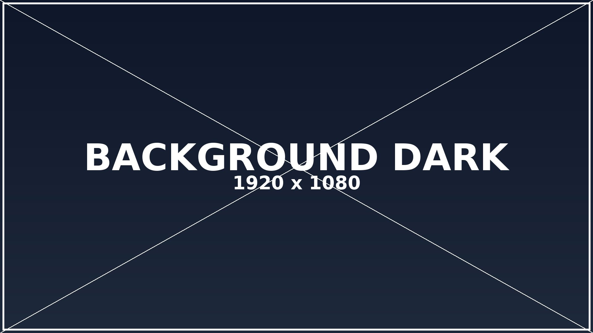
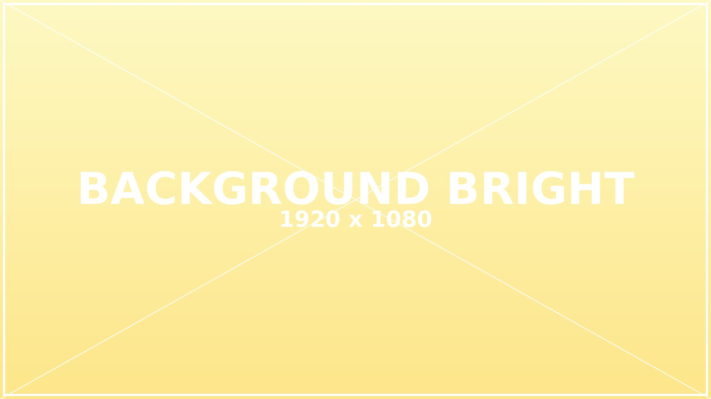

<!--
  このファイルは「警告が正しく出るか」と「おかしな入力でも落ちないか」を確かめる。
  期待する警告の一覧は fixtures/README.md にある。
  上のフロントマターの unknownKey も警告の対象。
-->

## 空行のない ---

この行の直後に空行なしで --- を書くと、この行は見出しになる
---

エディタは「--- の前に空行がない」と警告する。

## 書き間違えた属性 {lyout=split}

`lyout` は未知のキーなので、`{lyout=split}` は文字のまま表示し、「`layout` のことですか？」と警告する。

## 文中の波かっこ

テンプレートの例：こんにちは、{name} さん。

上の `{name}` は属性ではないので、文字のまま表示する（既知のキーではないため）。末尾の波かっこ {name}

エスケープした波かっこ \{step} も文字のまま表示する。

## 未知のコンテナ

:::colums
`colums` は未知のコンテナなので、警告を出し、中身は普通に表示する。
:::

## 閉じていないコンテナ

:::row
閉じる `:::` がないので、次の節の見出しの直前で閉じたものとして扱い、警告する。次の節以降は崩れない。

## 未知の指示

::toc

`::toc` は予約済みだが未定義なので、警告を出して文字のまま表示する。

## 水平線

上の段落。

***

`***` はスライドを区切らず、水平線になる。

___

`___` も同じ。

## 連続した ---

連続した `---` の間に内容がないので、空のスライドを作らない。

---

---

ここは2枚目。

## 1枚に収まらない段落

この段落はとても長い。一文ずつは短いが、段落全体ではスライド1枚に収まらない。そのため、文の切れ目で分割する。分割の位置は句点の直後になる。読点の位置では分割しない。この段落は、分割の動作を確かめるためだけに書いている。内容に意味はない。ただし、実際の資料でもこのように長い段落を書いてしまうことはある。その場合でも、資料が壊れずに表示されることが大切だ。この文で十分な長さになっただろうか。まだ足りないかもしれないので、もう少し続ける。スライドの論理サイズは 1280×720 で、本文の文字の大きさはテーマによって変わる。clean テーマでは、1行におよそ35文字、1枚におよそ12行が入る計算になる。つまり、1枚に入るのはおよそ420文字だ。この段落はそれを超える長さにしてある。ここまで来れば、さすがに1枚には収まらないはずだ。最後の文。

## 深い入れ子のリスト

- レベル1
  - レベル2
    - レベル3
      - レベル4
        - レベル5
          - レベル6

## 見出しのレベルの飛び

#### H4 がいきなり出てくる

`slideLevel: 2` なので、H4 はスライド内の小見出しとして扱う。レベルが飛んでいても警告はしない。

## 背景が2つ

{bg}
{bg}

背景が2つあるので「背景は1つだけ使う」と警告し、最初の画像を使う。

## 生 HTML

  生の HTML はそのまま出力する。

## 脚注とアラート

本文に脚注を付ける[^1]。

> [!WARNING]
> GitHub 形式のアラートは囲み枠になる。

> [!TIP]
> ヒントの枠。

[^1]: 脚注はスライドの下部に表示する。

## タスクリストと打ち消し線

- [x] 完了した項目
- [ ] 未完了の項目
- ~~取り消した項目~~

## 空の節

##
