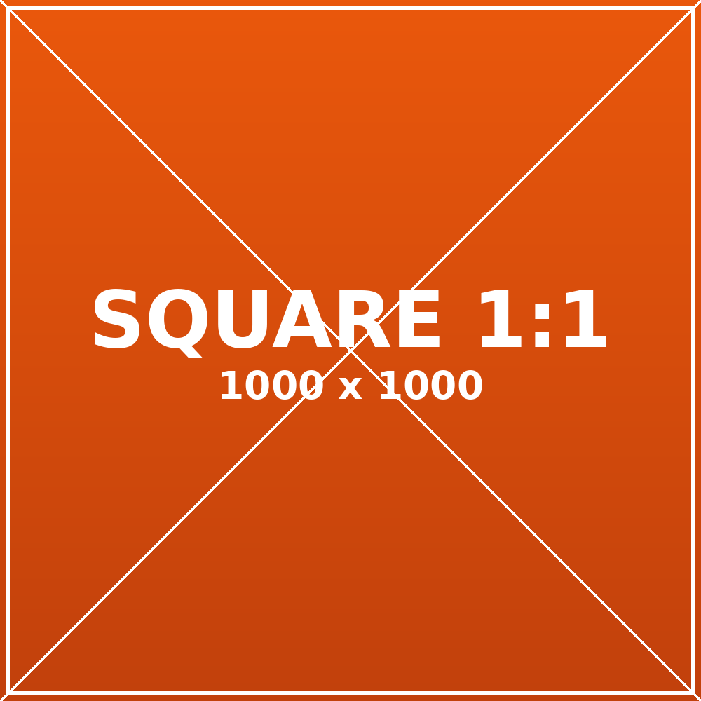

## 節A

この節は after.md でも変えない。

- A の項目1
- A の項目2

## 節B

after.md では、この節にだけ文章と項目を追加する。追加した文章によって、この節の内容は1枚に収まらなくなる。区切りの位置は、内容の増え方に合わせて自然に動く。

- B の項目1
- B の項目2
- B の項目3
- B の項目4（追加）
- B の項目5（追加）
- B の項目6（追加）
- B の項目7（追加）
- B の項目8（追加）
- B の項目9（追加）
- B の項目10（追加）
- B の項目11（追加）
- B の項目12（追加）

追加した段落。ここまでが固定した区切りの前に入る。

---

利用者が `---` で固定した区切りの後ろ。

## 節C {layout=split media=left}

この節は after.md でも変えない。指定したレイアウトも変わらない。
