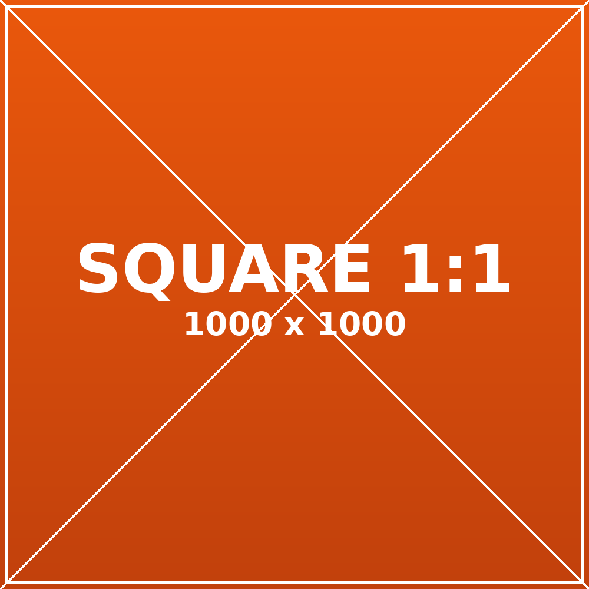

## 節A

この節は after.md でも変えない。

- A の項目1
- A の項目2

## 節B

after.md では、この節にだけ文章と項目を追加する。

- B の項目1
- B の項目2
- B の項目3

---

利用者が `---` で固定した区切りの後ろ。

## 節C {layout=split media=left}

この節は after.md でも変えない。指定したレイアウトも変わらない。
